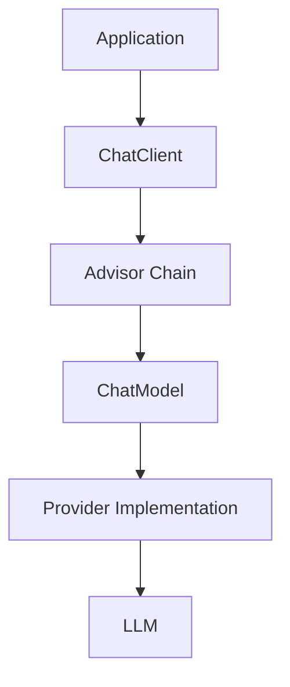

# ChatModel vs ChatClient

## 1. Visual Mental Model



## 2. ChatModel

Think: **How does my application communicate with the model?**

Use it for lower-level control, direct model interaction, custom orchestration, or specialized provider handling.

## 3. ChatClient

Think: **How does my application use AI?**

```java
String answer = chatClient
        .prompt()
        .user("Explain dependency injection")
        .call()
        .content();
```

## 4. Comparison

| ChatModel | ChatClient |
|---|---|
| Lower-level | Higher-level |
| Model abstraction | Application-facing fluent API |
| More control | Better developer ergonomics |
| Specialized orchestration | Typical application choice |

## 5. Interview Answer

ChatModel is the lower-level abstraction for a chat model implementation. ChatClient is the higher-level fluent API used by application code to compose prompts and AI behavior. I would normally use ChatClient and use ChatModel when specialized low-level orchestration is required.
