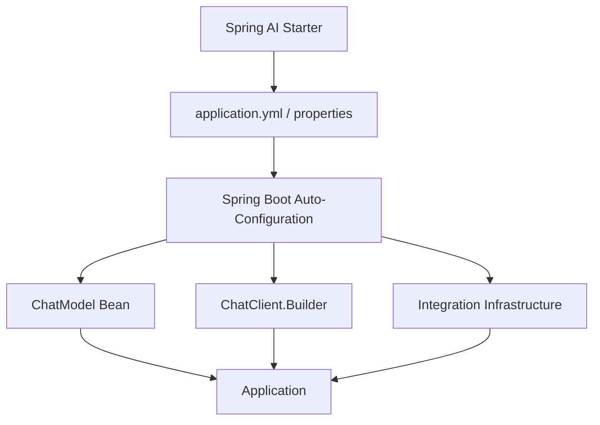
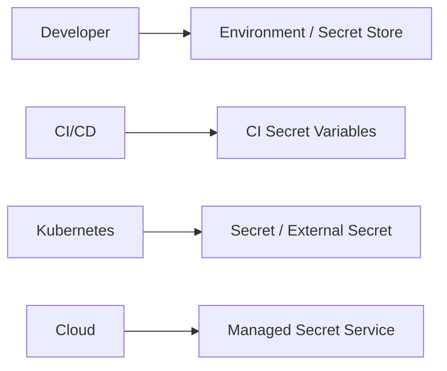

# Spring Boot Auto-Configuration for Spring AI

## 1. How Configuration Becomes Beans



## 2. Secure Configuration

```properties
spring.ai.openai.api-key=${OPENAI_API_KEY}
```



**Never commit provider API keys into Git.**

## 3. Good Practices

- Use the appropriate Spring AI starter.
- Inject configured beans instead of constructing provider clients everywhere.
- Externalize environment-specific configuration.
- Keep secrets outside source control.

## Interview Point

Auto-configuration reduces boilerplate, but senior engineers should understand bean creation, configuration resolution, and where application-specific overrides belong.
