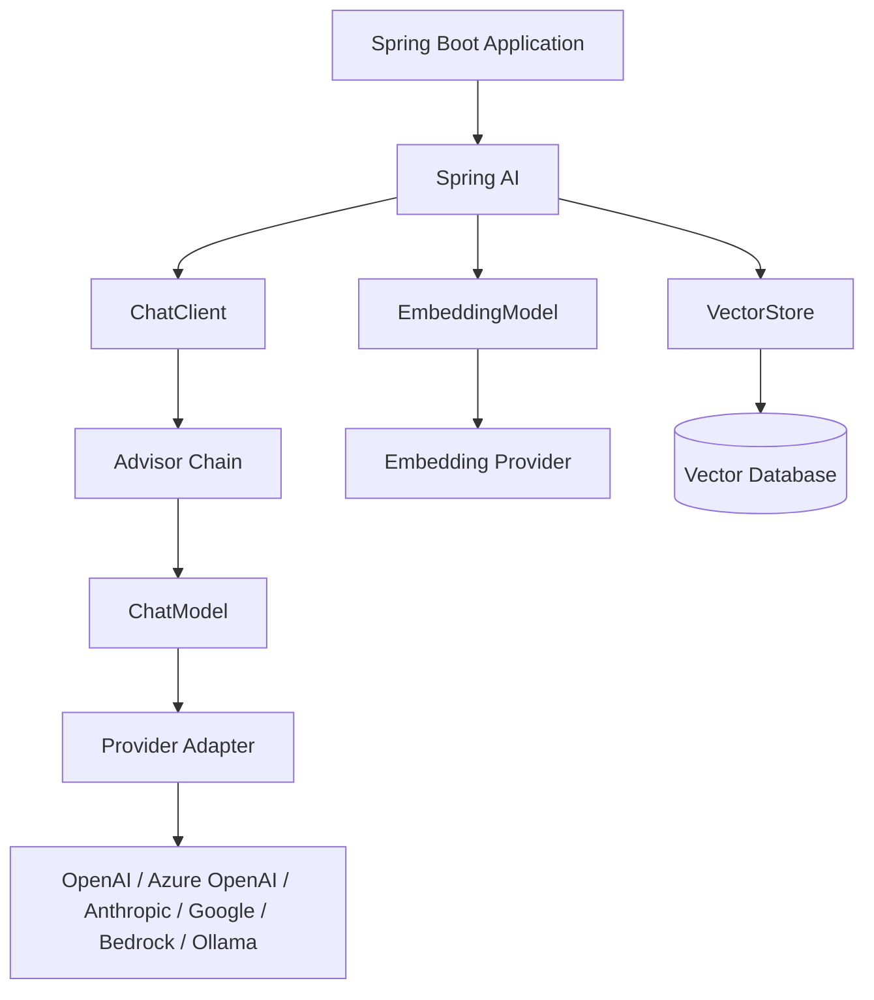
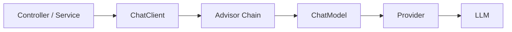
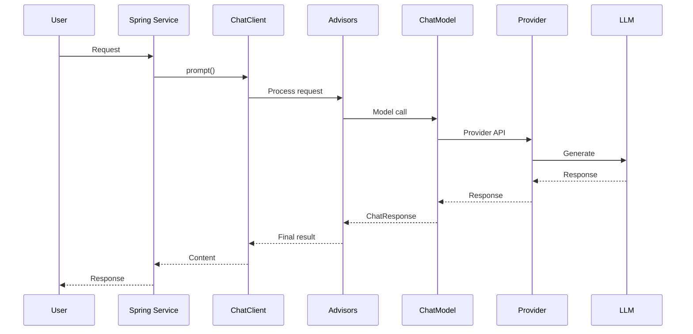
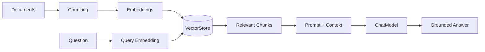
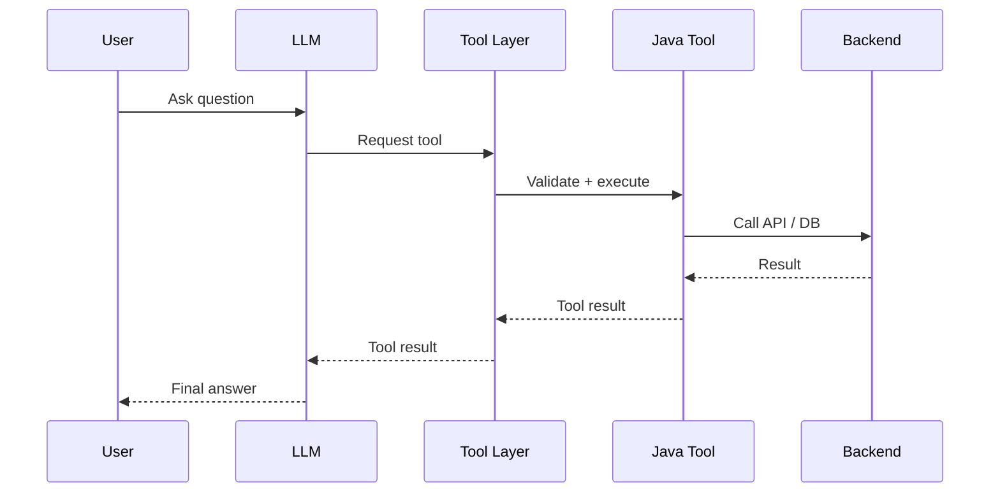
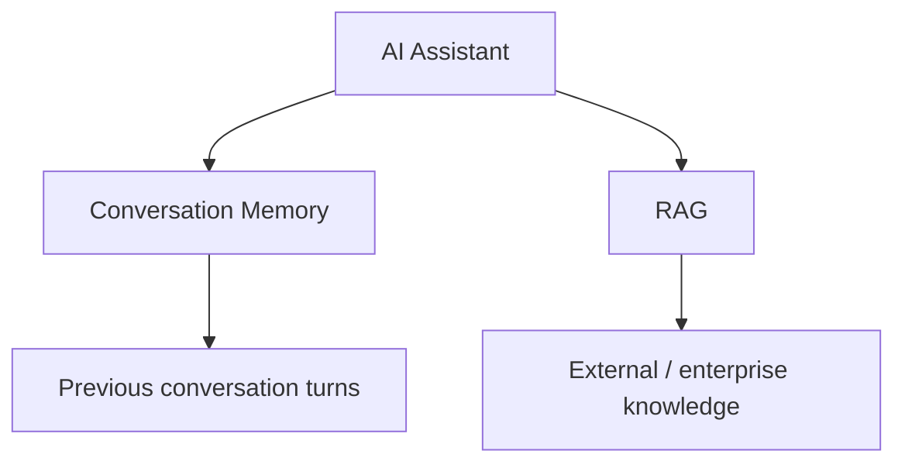
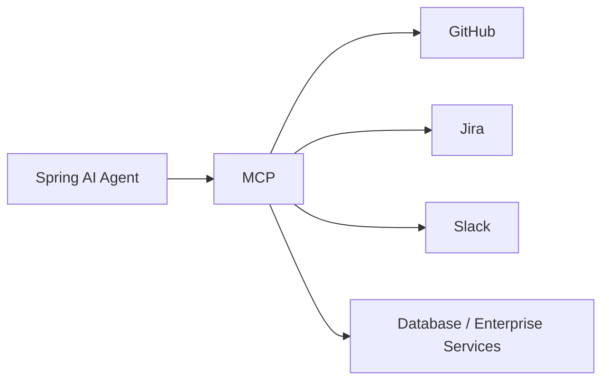
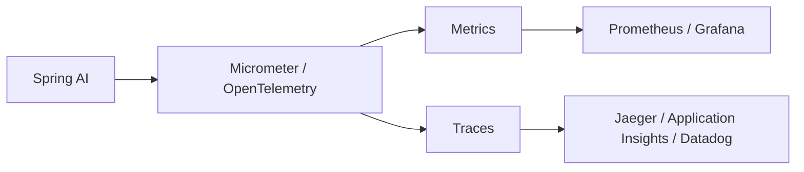
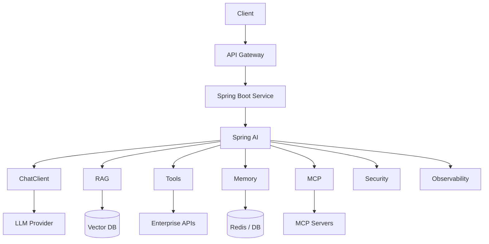

# Spring AI Fundamentals — Visual Study Map

This companion page is intentionally visual-first, following the style of the repository's Spring Data JPA guide.

## 1. Big Picture



## 2. ChatClient vs ChatModel



**Remember:** ChatClient is the application-facing fluent API. ChatModel is the lower-level model abstraction.

## 3. Request Lifecycle



## 4. RAG in One Picture



## 5. Tool Calling



**Security boundary:** the model requests a tool; the application owns authorization and execution.

## 6. Memory vs RAG



**Memory:** what was discussed.

**RAG:** what the enterprise knows.

## 7. MCP



MCP is the interoperability layer for discovering/consuming external capabilities.

## 8. Observability



Track latency, time-to-first-token, provider/model, token usage, retrieval latency, tool failures, errors, retries, and cost.

## 9. Production Architecture



## 10. Interview Comparison

| Concept | One-line answer |
|---|---|
| Spring AI | Spring ecosystem abstraction for AI applications |
| ChatClient | High-level fluent application API |
| ChatModel | Lower-level model abstraction |
| EmbeddingModel | Text to vector representation |
| VectorStore | Store/search semantic vectors |
| Advisor | Reusable AI request/response middleware |
| Tool | Controlled backend/application capability |
| Memory | Conversation history |
| RAG | Retrieve relevant knowledge before generation |
| MCP | Standardized interoperability for AI capabilities |

## 11. Lead-Level Questions

1. Why use Spring AI instead of a vendor SDK directly?
2. ChatClient vs ChatModel?
3. Does provider abstraction guarantee feature parity?
4. How do Advisors change request processing?
5. How do you prevent N+1-style retrieval/tool overhead in an AI workflow?
6. How do you secure tools?
7. How do you isolate tenant data in RAG and memory?
8. How do you trace token/cost/latency end to end?
9. How do you design provider fallback?
10. How do you evaluate whether a RAG change actually improved answer quality?

## 12. One-Minute Revision

```text
Spring Boot
    |
    v
ChatClient
    |
Advisors ---- Memory / RAG / Tools
    |
    v
ChatModel
    |
Provider
    |
LLM

RAG: Documents -> Chunks -> Embeddings -> VectorStore -> Context -> LLM

Agent: Goal -> LLM -> Tool -> Result -> LLM -> Next step -> Answer

Production: Security + Observability + Evaluation + Cost + Reliability
```

## References
- https://docs.spring.io/spring-ai/reference/
- https://docs.spring.io/spring-ai/reference/api/chatclient.html
- https://docs.spring.io/spring-ai/reference/api/chatmodel.html
- https://docs.spring.io/spring-ai/reference/api/advisors.html
- https://docs.spring.io/spring-ai/reference/api/tools.html
