# Spring AI Fundamentals

## Goal
Build a strong foundation for Senior / Lead Java AI Engineer interviews and production development.

Spring AI brings Spring-style abstractions to AI application development, including chat models, embeddings, vector stores, structured output, tools, Advisors, memory, RAG, MCP, observability, evaluation, and document ETL.

## 1. What is Spring AI?

Spring AI is an application framework in the Spring ecosystem for integrating AI capabilities into Spring Boot applications.

### Mental model

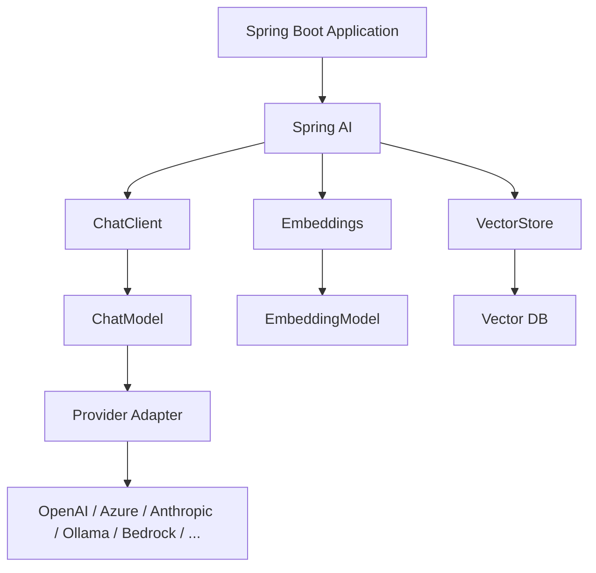

Spring AI provides common abstractions while still allowing provider-specific capabilities.

## 2. Why Spring AI?

Without an abstraction:

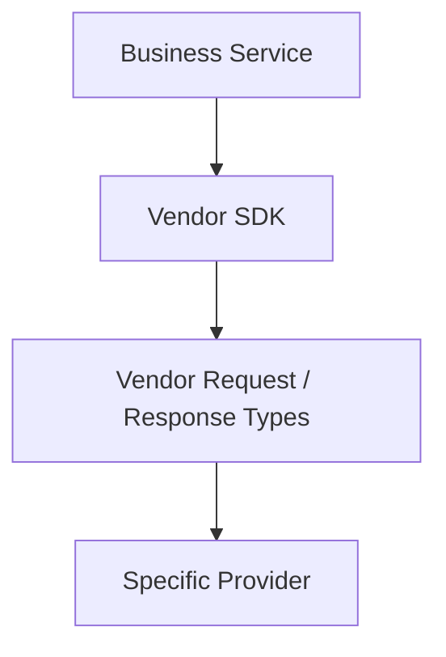

With Spring AI:

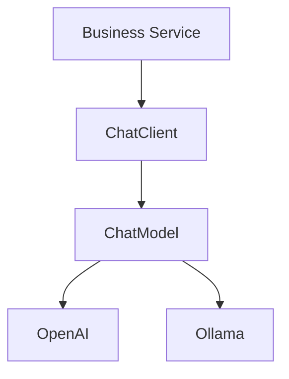

Benefits:
- Provider portability
- Spring Boot auto-configuration
- Dependency injection
- Common AI patterns
- Reusable Advisors
- Vector-store abstraction
- Tool calling
- RAG support
- Observability and evaluation

## 3. Core Building Blocks

| Component | Purpose |
|---|---|
| ChatClient | High-level fluent API for application code |
| ChatModel | Lower-level chat model abstraction |
| StreamingChatModel | Streaming chat interaction |
| EmbeddingModel | Converts text into vectors |
| VectorStore | Stores/searches embedded documents |
| Document | Content + metadata used in ingestion/retrieval |
| Advisors | Reusable AI request/response patterns |
| Tools | Application functions that a model can request |
| ChatMemory | Conversation history |
| MCP | Interoperable tools/resources/prompts |
| ETL | Document ingestion pipeline |

## 4. ChatModel vs ChatClient

### ChatModel
Think: **How do I communicate with the model?**

Use it when you need lower-level control or custom orchestration.

### ChatClient
Think: **How does my application use AI?**

Example:

```java
String answer = chatClient
        .prompt()
        .user("Explain dependency injection")
        .call()
        .content();
```

### Comparison

| ChatModel | ChatClient |
|---|---|
| Lower-level | Higher-level |
| Provider/model abstraction | Application-facing fluent API |
| More control | Better developer ergonomics |
| Useful for custom orchestration | Best for most application flows |

## 5. Request Lifecycle

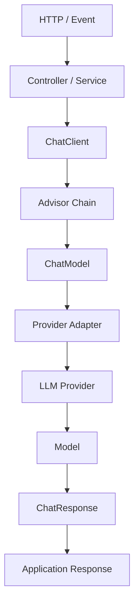

The Advisor chain is where reusable behaviors such as retrieval, memory, and tool calling can participate in the request.

## 6. Spring Boot Auto-Configuration

Conceptually:

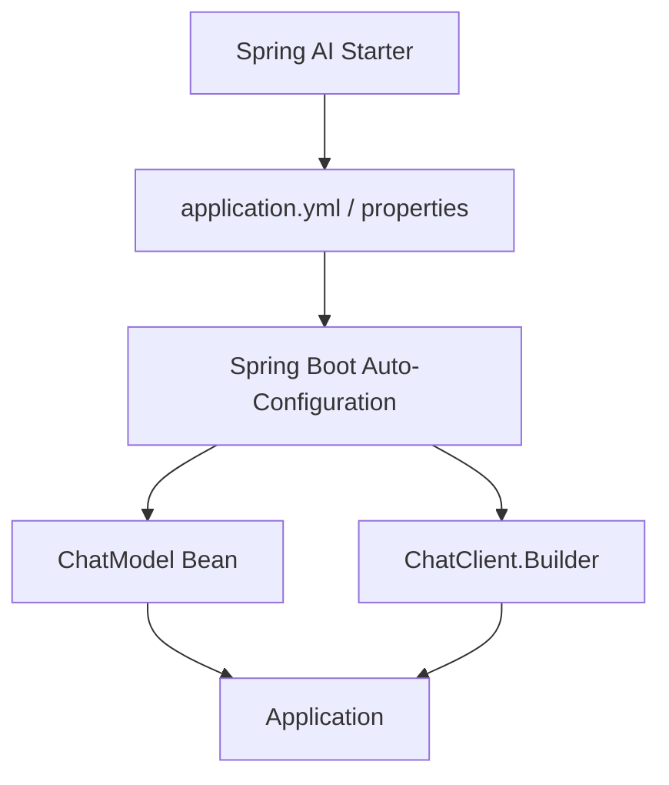

Benefits:
- Less boilerplate
- Externalized configuration
- Environment-specific configuration
- Dependency injection
- Easy provider configuration

### Secure configuration

```properties
spring.ai.openai.api-key=${OPENAI_API_KEY}
```

Never commit real provider secrets.

## 7. Provider Abstraction

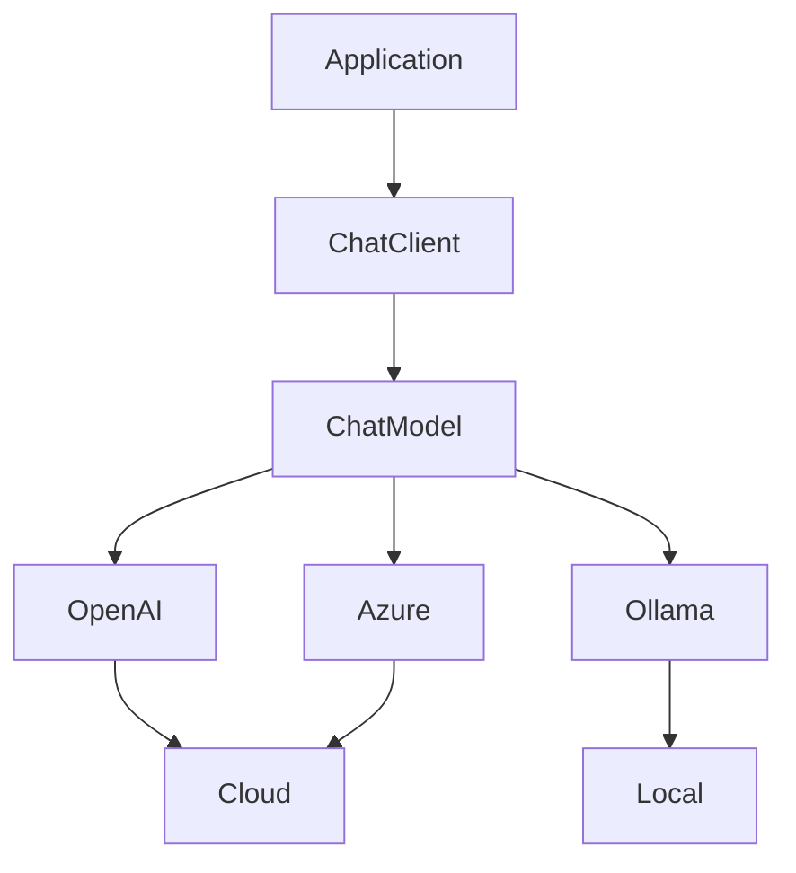

### Important interview point

Portability does **not** mean feature parity.

Providers can differ in:
- Tool calling
- Streaming
- Multimodality
- Structured output
- Context window
- Latency
- Cost
- Model quality

Design around the common abstraction, but verify capabilities before switching providers.

## 8. Prompt and Message Basics

A model request can contain:

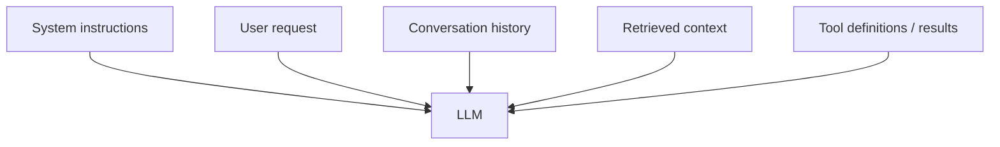

System prompts define behavior and policy. User prompts carry the current task.

Authorization must be enforced by the application, not trusted to a prompt.

## 9. call() vs stream()

### call()
Best when the caller needs a complete result.

```java
String answer = chatClient
        .prompt("Explain event-driven architecture")
        .call()
        .content();
```

### stream()
Best when the client should receive progressive output.

```java
Flux<String> stream = chatClient
        .prompt("Explain microservices")
        .stream()
        .content();
```

## 10. Structured Output

Enterprise Java applications usually need typed objects rather than free-form text.

```java
record IncidentSummary(
        String severity,
        String summary,
        List<String> probableCauses
) {}
```

Pipeline:

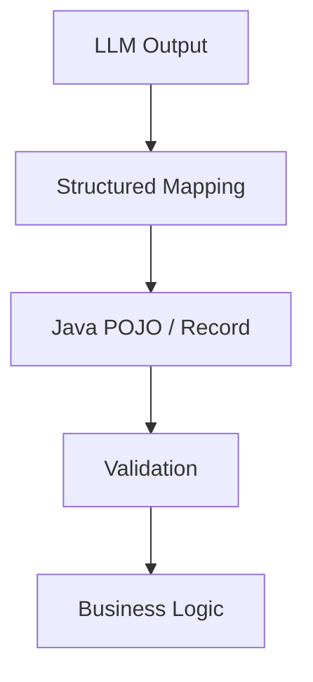

Treat model output as untrusted input and validate it.

## 11. Embeddings

Embeddings convert text into numerical vectors.

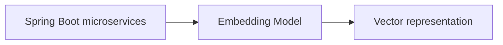

Embeddings are primarily used for semantic retrieval and similarity.

### Chat model vs embedding model

| Chat Model | Embedding Model |
|---|---|
| Generates responses | Generates vectors |
| Used for generation | Used for similarity/retrieval |
| Produces text/content | Produces numerical representation |

## 12. VectorStore

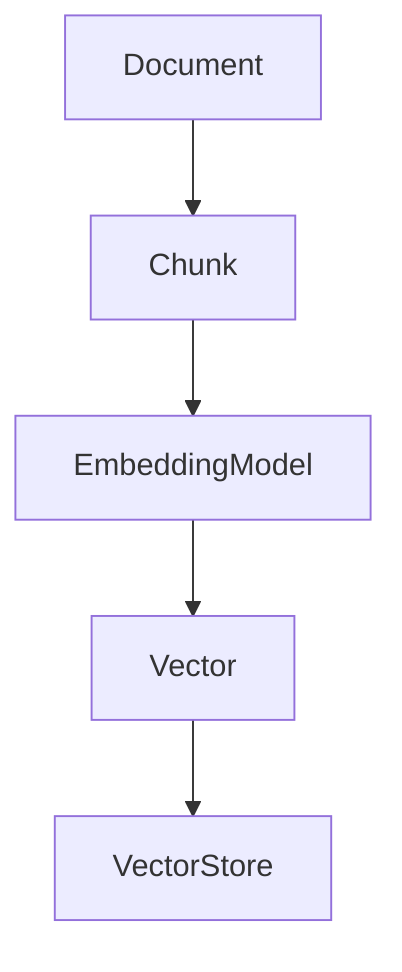

At query time:

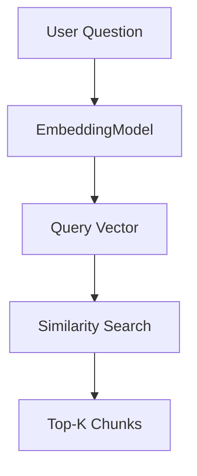

Spring AI provides a portable VectorStore API across many vector database integrations.

## 13. Advisors

An Advisor is reusable AI request/response processing logic.

Think:

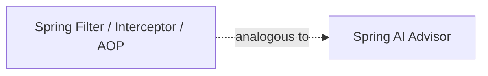

Examples:
- Memory
- Retrieval
- Tool calling
- Safety
- Reasoning patterns
- Custom application logic

### Advisor chain

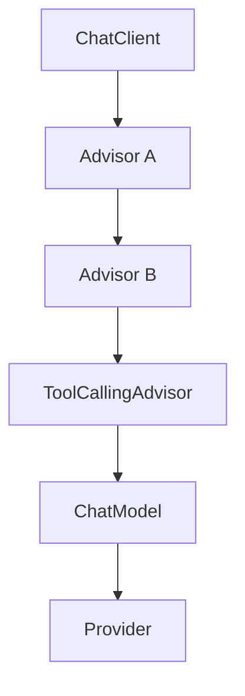

Advisor ordering can change application behavior, so it is a lead-level design concern.

## 14. Tool Calling

Tool calling allows a model to request that the **application** invoke a function.

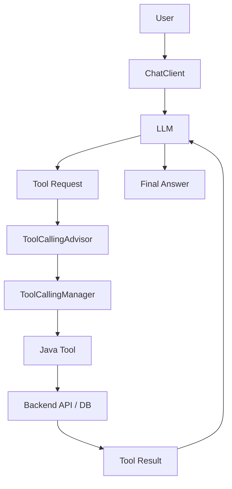

Critical security principle:

> The model requests a tool. The application owns the actual execution and authorization.

In the current Spring AI 2.x architecture, ChatClient's tool-calling loop is handled by ToolCallingAdvisor.

## 15. Chat Memory

Conversation memory stores interaction history.

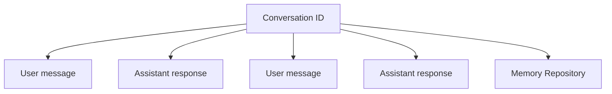

Memory is different from RAG:

- Memory = conversation history
- RAG = external/domain knowledge retrieval

They can be combined.

## 16. MCP

Model Context Protocol standardizes interoperability with external tools, resources, and prompts.

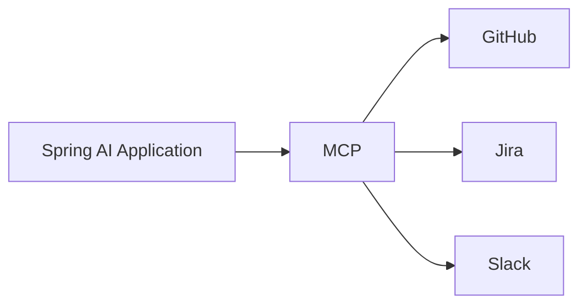

Spring AI can consume MCP server capabilities and expose Spring-based capabilities through an MCP server.

## 17. RAG Fundamentals

### Ingestion

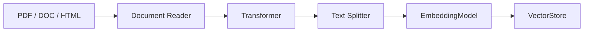

### Query

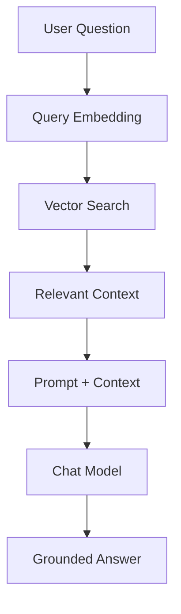

RAG can ground answers in external data, but it does not guarantee correctness. Retrieval quality, authorization, chunking, ranking, prompts, and model behavior still matter.

## 18. Observability

Monitor more than HTTP requests:

- Total latency
- Time to first token
- Model/provider
- Token usage
- Error rate
- Retry count
- Retrieval latency
- Tool-call count/failures
- Cost
- Correlation/trace ID

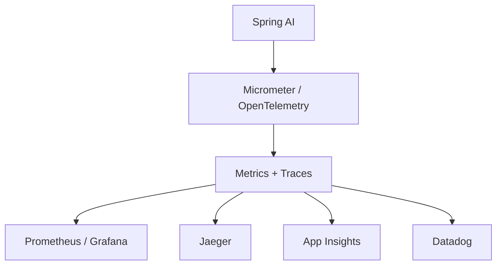

## 19. Security

Treat model input and output as untrusted.

Key risks:
- Prompt injection
- Data leakage
- Excessive tool permissions
- Cross-tenant retrieval
- Secrets in prompts
- Unsafe generated actions

Secure flow:

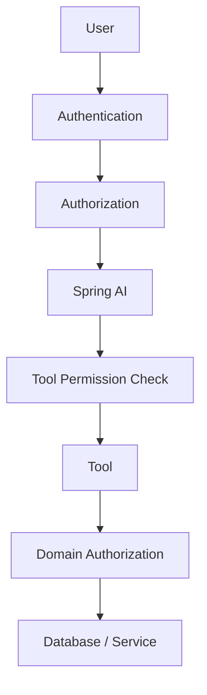

Never rely on an LLM prompt as the security boundary.

## 20. Production Readiness Checklist

### Model
- Model selected for quality, cost, latency
- Fallback defined
- Provider outage strategy

### Prompt
- Prompt versioned
- User input isolated from policy
- Injection risks reviewed

### RAG
- Retrieval authorization
- Chunking strategy
- Evaluation dataset

### Tools
- Least privilege
- Input validation
- Idempotency
- Audit logs
- Human approval for destructive actions

### Memory
- Retention policy
- Tenant isolation
- Context-window control

### Observability
- Tracing
- Token/cost metrics
- Provider/model visibility

### Evaluation
- Golden tests
- Regression checks
- Relevance/groundedness checks

## Must-Know Checklist

- [ ] What Spring AI solves
- [ ] ChatModel
- [ ] ChatClient
- [ ] Auto-configuration
- [ ] Provider abstraction
- [ ] Prompt/message model
- [ ] call() vs stream()
- [ ] Structured output
- [ ] Embeddings
- [ ] VectorStore
- [ ] Advisors
- [ ] Tool calling
- [ ] Chat memory
- [ ] RAG
- [ ] MCP
- [ ] Observability
- [ ] Security
- [ ] Production trade-offs

## Official References

- https://docs.spring.io/spring-ai/reference/
- https://docs.spring.io/spring-ai/reference/api/chatclient.html
- https://docs.spring.io/spring-ai/reference/api/chatmodel.html
- https://docs.spring.io/spring-ai/reference/api/advisors.html
- https://docs.spring.io/spring-ai/reference/api/tools.html
