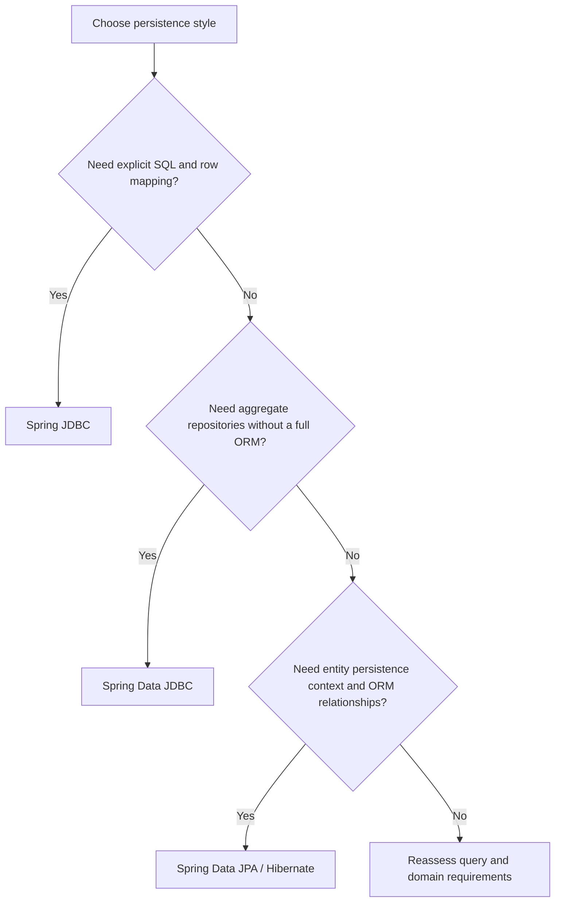

# Spring JDBC & Spring Data Persistence — Preparation Guide

This folder contains practical notes, visual explanations, Spring Boot examples, and senior-level interview preparation for the main JDBC and JPA persistence approaches.

## Learning path

The recommended order is:

1. **[Spring JDBC](./Spring%20JDBC.md)** — Start with JDBC fundamentals, SQL execution, JdbcTemplate, RowMapper, named parameters, batching, exception translation, transactions, and connection pooling.
2. **[Spring Data JDBC](./SpringDataJDBC.md)** — Learn repository-based persistence with aggregate roots, explicit saves, relational mapping, optimistic locking, and custom queries.
3. **[Spring Data JPA](./SpringDataJPA.md)** — Learn entities, relationships, persistence context, dirty checking, fetching, JPQL, transactions, locking, and ORM performance.

## At a glance: which approach should I use?

| Approach | Main abstraction | SQL and mapping | Key behavior | Typical fit |
|---|---|---|---|---|
| Spring JDBC | JdbcTemplate | Developer writes SQL and maps rows | No ORM persistence context | SQL-centric queries, bulk operations, precise SQL control |
| Spring Data JDBC | Aggregate repositories | Generated CRUD with relational aggregate mapping | Explicit aggregate save; no JPA-style dirty checking | Simple aggregate-oriented domain persistence |
| Spring Data JPA | JpaRepository / EntityManager | Entity mapping with JPQL/native SQL and generated SQL | Persistence context, dirty checking, entity relationships | Rich domain models that benefit from ORM features |

## Core concepts to understand

- **DataSource and connection pooling:** how application code obtains database connections.
- **Repository and DAO patterns:** separating persistence code from business logic.
- **Object-relational mapping:** mapping Java types and fields to relational tables and columns.
- **Transactions:** defining atomic business operations with @Transactional.
- **Concurrency:** optimistic locking, pessimistic locking, and isolation.
- **Performance:** query plans, indexing, pagination, batching, fetch plans, and N+1 queries.
- **Testing:** validating mappings and database behavior with integration tests.

## Visual overview

## Interview preparation checklist

- Explain the difference between Spring JDBC, Spring Data JDBC, JPA, Hibernate, and Spring Data JPA.
- Describe what happens from a repository method call to SQL execution.
- Explain RowMapper, ResultSetExtractor, and RowCallbackHandler.
- Explain aggregate roots and Spring Data JDBC save behavior.
- Explain JPA persistence context, first-level cache, dirty checking, and flush vs commit.
- Compare lazy/eager fetching and solve the N+1 query problem.
- Explain owning sides, mappedBy, cascades, and orphan removal.
- Describe transaction propagation, rollback rules, and locking.
- Explain batch writes, pagination, projections, and production diagnostics.

## Files in this folder

| File | Contents |
|---|---|
| [Spring JDBC.md](./Spring%20JDBC.md) | JDBC fundamentals, JdbcTemplate, SQL examples, transactions, batching, exception handling, production guidance, and embedded Mermaid visualizations |
| [SpringDataJDBC.md](./SpringDataJDBC.md) | Aggregate-oriented Spring Data JDBC, repository examples, relational mapping, optimistic locking, testing, and interview questions |
| [SpringDataJPA.md](./SpringDataJPA.md) | JPA entities and relationships, persistence context, dirty checking, fetch strategies, N+1, transactions, locking, projections, and interview questions |

## Suggested hands-on practice

1. Build the same CRUD use case with JdbcTemplate, Spring Data JDBC, and Spring Data JPA.
2. Add a parent-child relationship and compare how each approach persists it.
3. Add a transactional business operation and verify rollback behavior.
4. Create a paginated search endpoint and inspect its SQL.
5. Trigger and fix an N+1 query in JPA using an entity graph or fetch join.
6. Add optimistic locking and simulate concurrent updates.
7. Compare query counts and execution plans before and after performance improvements.

## Official documentation

- [Spring Framework JDBC](https://docs.spring.io/spring-framework/reference/data-access/jdbc.html)
- [Spring Data JDBC](https://docs.spring.io/spring-data/relational/reference/jdbc.html)
- [Spring Data JPA](https://docs.spring.io/spring-data/jpa/reference/)
- [Hibernate ORM](https://hibernate.org/orm/documentation/)
- [Spring Boot](https://docs.spring.io/spring-boot/reference/)

---

**Goal:** Be able to select the right persistence approach, explain its internal behavior, write maintainable repository/service code, and troubleshoot database performance and transaction issues in production.
