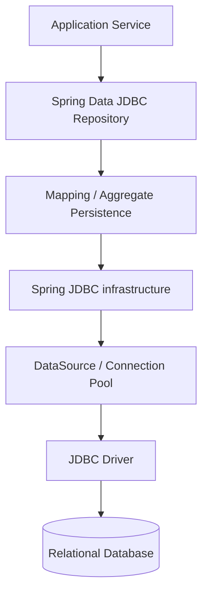
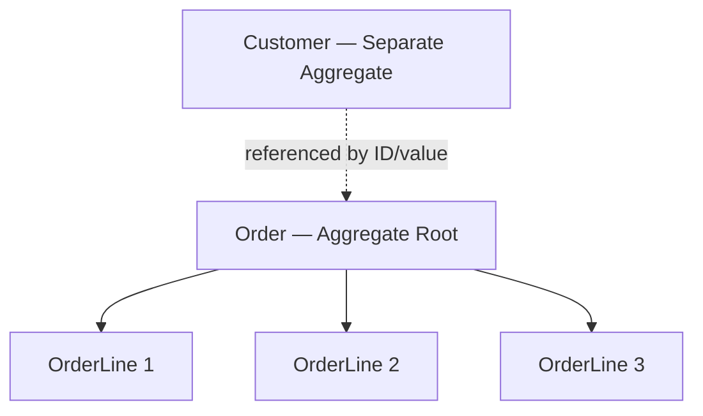
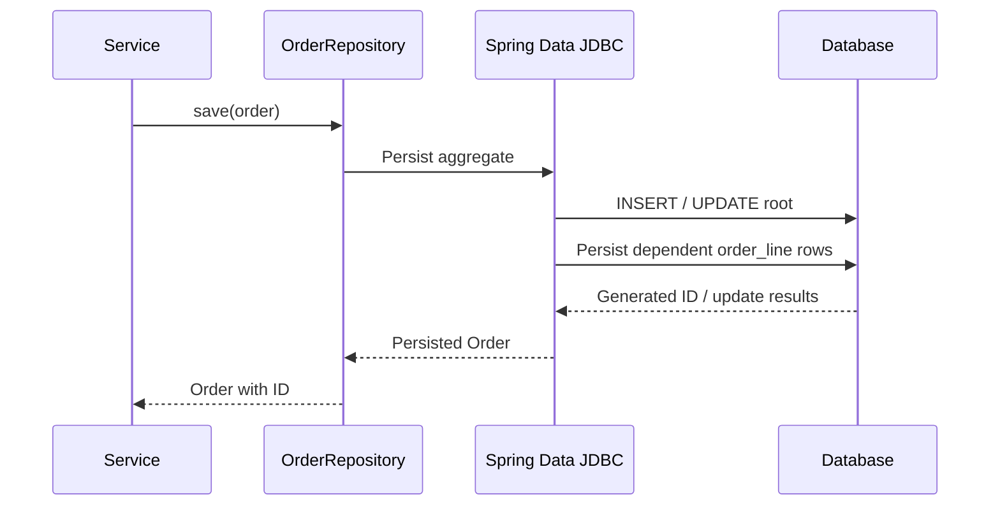
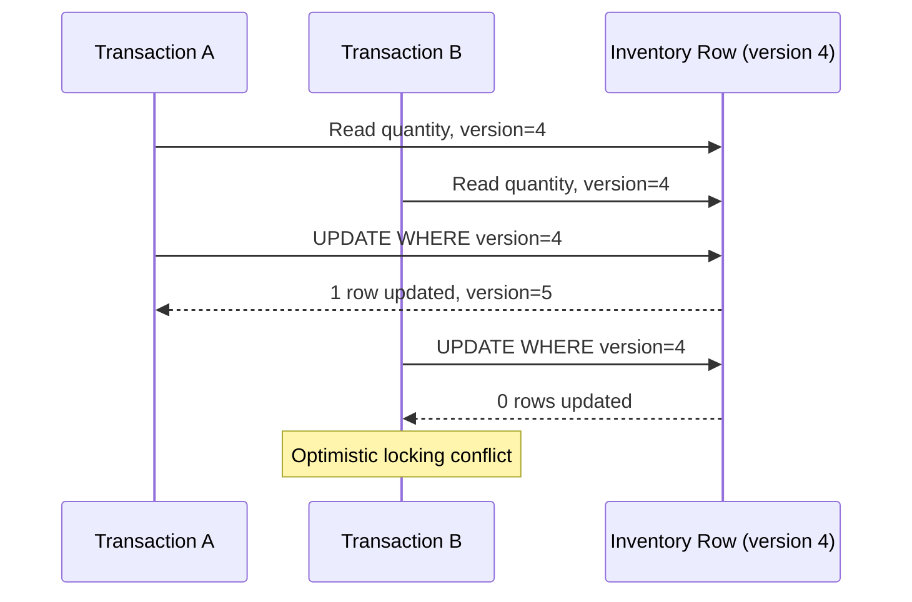
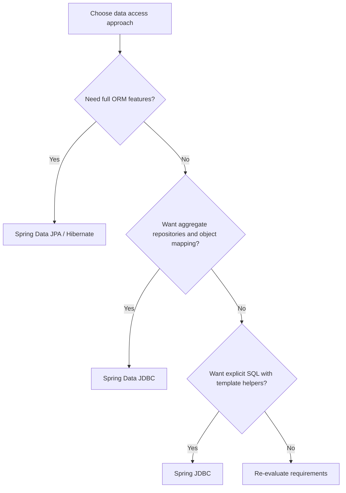

# Spring Data JDBC — Visual Guide, Examples & Senior Interview Preparation

Spring Data JDBC is a Spring Data module for **aggregate-oriented relational persistence**. It provides repository abstractions and object-to-table mapping while keeping the relational model and SQL behavior simpler and more explicit than a full ORM such as JPA/Hibernate.

> **Core idea:** Model an aggregate, expose it through a repository, and let Spring Data JDBC generate the common CRUD SQL. Use custom SQL when a use case needs more control.

## 1. What is Spring Data JDBC?

Spring Data JDBC sits on top of the JDBC infrastructure. It maps domain objects to relational tables and provides repository interfaces for common persistence operations.

It is designed around **aggregates and aggregate roots** from Domain-Driven Design (DDD). The aggregate root is the object through which the aggregate is loaded and persisted.

Spring Data JDBC is not the same as:
- **Spring JDBC:** lower-level SQL access using `JdbcTemplate` / `NamedParameterJdbcTemplate`; you write SQL and usually map rows yourself.
- **Spring Data JPA:** repository abstraction over JPA; commonly uses an ORM such as Hibernate, entity state tracking, and persistence context semantics.
- **Hibernate:** ORM implementation with features such as dirty checking, lazy loading, and first-level persistence context.

### A quick mental model



Repository methods give you convenient CRUD operations. Spring Data JDBC translates aggregate persistence into SQL using standard JDBC infrastructure.

## 2. Where does Spring Data JDBC fit?

| Technology | Main abstraction | Who writes SQL? | ORM behavior |
|---|---|---|---|
| Plain JDBC | `Connection`, `PreparedStatement`, `ResultSet` | Developer | None |
| Spring JDBC | `JdbcTemplate` | Developer | None |
| Spring Data JDBC | Aggregate repositories | Framework for standard CRUD; developer for custom SQL | Deliberately limited |
| Spring Data JPA | Repository + JPA EntityManager | Often framework/JPQL; custom SQL also possible | Full JPA ORM provider, commonly Hibernate |
| Hibernate | Session / ORM | Often generated; HQL/native SQL available | Full ORM |

**When Spring Data JDBC is a good fit**
- You want repository-based CRUD without a full ORM persistence context.
- Your domain is naturally modeled as aggregates.
- You prefer explicit aggregate persistence behavior and fewer ORM lifecycle surprises.
- You want to work with SQL relational databases and JDBC drivers.

**When it may not be the best fit**
- Your use case depends heavily on lazy loading, complex entity graphs, or ORM dirty checking.
- You need very complex read/reporting queries: Spring JDBC or a dedicated query layer may be a better fit.
- Your domain has many cross-aggregate relationships that would make aggregate boundaries unclear.

## 3. Dependencies and database configuration

Use Spring Boot dependency management so compatible versions are selected. Add the Spring Data JDBC starter and a database driver.

### Maven — PostgreSQL

```xml
<dependencies>
    <dependency>
        <groupId>org.springframework.boot</groupId>
        <artifactId>spring-boot-starter-data-jdbc</artifactId>
    </dependency>

    <dependency>
        <groupId>org.postgresql</groupId>
        <artifactId>postgresql</artifactId>
        <scope>runtime</scope>
    </dependency>
</dependencies>
```

For local tests, you may use H2 instead of PostgreSQL:

```xml
<dependency>
    <groupId>com.h2database</groupId>
    <artifactId>h2</artifactId>
    <scope>runtime</scope>
</dependency>
```

Do not add JPA just to use Spring Data JDBC. The Data JDBC starter provides the JDBC-based Spring Data integration.

### application.properties — PostgreSQL

```properties
spring.datasource.url=jdbc:postgresql://localhost:5432/orders
spring.datasource.username=postgres
spring.datasource.password=${DB_PASSWORD}
# Driver class is normally inferred from the JDBC URL:
# spring.datasource.driver-class-name=org.postgresql.Driver
```

Keep credentials outside source control. Spring Boot auto-configures the DataSource from these properties when the driver is present.

### Schema initialization

For production systems, prefer a schema migration tool such as Flyway or Liquibase so schema changes are versioned and repeatable.

Example schema used in the guide:

```sql
CREATE TABLE customer_order (
    id BIGINT GENERATED BY DEFAULT AS IDENTITY PRIMARY KEY,
    order_number VARCHAR(40) NOT NULL UNIQUE,
    customer_name VARCHAR(120) NOT NULL,
    status VARCHAR(30) NOT NULL
);

CREATE TABLE order_line (
    id BIGINT GENERATED BY DEFAULT AS IDENTITY PRIMARY KEY,
    order_id BIGINT NOT NULL REFERENCES customer_order(id),
    product_code VARCHAR(40) NOT NULL,
    quantity INTEGER NOT NULL,
    unit_price NUMERIC(12, 2) NOT NULL
);
```

## 4. Understand aggregate roots first

This is the most important Spring Data JDBC concept.

An **aggregate** is a cluster of domain objects treated as one consistency boundary. The **aggregate root** is the entry point for loading and saving that cluster.

Example: an Order owns its OrderLine objects.



Rules of thumb:
- Other aggregates should reference an aggregate root by identity, not by directly embedding an entire mutable object graph.
- Update an Order's lines through the Order aggregate root.
- Do not create a repository for every child object merely because it has a table.
- Keep aggregate boundaries small enough to load and update as a unit.
- Aggregate boundaries are domain design decisions, not just database foreign-key relationships.

### Why does this matter?

Spring Data JDBC persists an aggregate as a unit. On save, it determines the aggregate's current state and writes the relevant rows. It does not behave like JPA's managed entity graph with automatic dirty checking on every field mutation.

## 5. Build a domain model

Spring Data JDBC maps domain objects to tables. Use `@Table`, `@Id`, and `@Column` when you need explicit names.

### Order aggregate root

```java
import org.springframework.data.annotation.Id;
import org.springframework.data.relational.core.mapping.Column;
import org.springframework.data.relational.core.mapping.MappedCollection;
import org.springframework.data.relational.core.mapping.Table;

import java.util.ArrayList;
import java.util.List;

@Table("customer_order")
public class Order {

    @Id
    private Long id;

    @Column("order_number")
    private String orderNumber;

    @Column("customer_name")
    private String customerName;

    private String status;

    @MappedCollection(idColumn = "order_id")
    private List<OrderLine> lines = new ArrayList<>();

    protected Order() {
        // Required by mapping infrastructure.
    }

    public Order(String orderNumber, String customerName,
                 List<OrderLine> lines) {
        this.orderNumber = orderNumber;
        this.customerName = customerName;
        this.status = "CREATED";
        this.lines = new ArrayList<>(lines);
    }

    public Long getId() { return id; }
    public String getOrderNumber() { return orderNumber; }
    public String getCustomerName() { return customerName; }
    public String getStatus() { return status; }
    public List<OrderLine> getLines() { return List.copyOf(lines); }

    public void addLine(OrderLine line) {
        this.lines.add(line);
    }

    public void changeStatus(String newStatus) {
        this.status = newStatus;
    }
}
```

### Child entity: OrderLine

```java
import org.springframework.data.relational.core.mapping.Table;
import java.math.BigDecimal;

@Table("order_line")
public class OrderLine {

    private String productCode;
    private int quantity;
    private BigDecimal unitPrice;

    protected OrderLine() {
    }

    public OrderLine(String productCode, int quantity,
                     BigDecimal unitPrice) {
        if (quantity <= 0) {
            throw new IllegalArgumentException("quantity must be positive");
        }
        this.productCode = productCode;
        this.quantity = quantity;
        this.unitPrice = unitPrice;
    }

    public String getProductCode() { return productCode; }
    public int getQuantity() { return quantity; }
    public BigDecimal getUnitPrice() { return unitPrice; }
}
```

Notes:
- `@Table` maps a domain type to a table.
- `@Id` identifies the primary key.
- `@Column` customizes a column name.
- `@MappedCollection` models a dependent collection within the aggregate. `idColumn` identifies the foreign-key column in the child table.
- The child does not need its own repository if it belongs to the Order aggregate.
- For immutable models, records, constructor mapping, and persistence creator conventions can be used; make sure the mapping constructor is unambiguous and supported by your Spring Data version.

## 6. Repository — the main persistence API

Extend `CrudRepository` to get common CRUD operations.

```java
import org.springframework.data.repository.CrudRepository;
import java.util.Optional;

public interface OrderRepository extends CrudRepository<Order, Long> {

    Optional<Order> findByOrderNumber(String orderNumber);

    Iterable<Order> findByStatus(String status);

    boolean existsByOrderNumber(String orderNumber);
}
```

Common inherited methods include:
- `save(entity)`
- `findById(id)`
- `findAll()`
- `existsById(id)`
- `count()`
- `deleteById(id)`
- `delete(entity)`

Derived query methods are parsed from method names. For complex SQL, projections, joins, or database-specific queries, use an appropriate custom query approach rather than forcing a very long method name.

### Repository flow



Exact SQL statements and ordering depend on mapping metadata, dialect, and framework version. Think in terms of aggregate persistence semantics rather than relying on a particular generated statement sequence.

## 7. Service layer and transaction boundary

Place business use cases in a service and use transactions for multi-step operations.

```java
import org.springframework.stereotype.Service;
import org.springframework.transaction.annotation.Transactional;
import java.util.List;

@Service
public class OrderService {

    private final OrderRepository orderRepository;

    public OrderService(OrderRepository orderRepository) {
        this.orderRepository = orderRepository;
    }

    @Transactional
    public Order createOrder(String orderNumber,
                             String customerName,
                             List<OrderLine> lines) {
        if (orderRepository.existsByOrderNumber(orderNumber)) {
            throw new IllegalArgumentException("Order number already exists");
        }

        Order order = new Order(orderNumber, customerName, lines);
        return orderRepository.save(order);
    }

    @Transactional(readOnly = true)
    public Order getOrder(long id) {
        return orderRepository.findById(id)
            .orElseThrow(() -> new IllegalArgumentException("Order not found"));
    }

    @Transactional
    public Order updateStatus(long id, String status) {
        Order order = orderRepository.findById(id)
            .orElseThrow(() -> new IllegalArgumentException("Order not found"));

        order.changeStatus(status);
        return orderRepository.save(order);
    }
}
```

**Important:** Do not assume that modifying a loaded object and returning it automatically persists the change. Spring Data JDBC is not JPA's managed persistence context. Explicitly call `save` when you change an aggregate.

In a real system, avoid a check-then-insert race for unique order numbers. Keep the database unique constraint and handle the resulting integrity violation; the service-level existence check is only a friendly early validation.

## 8. What happens during save()?

Spring Data JDBC does not use JPA-style dirty checking. Calling `save` persists the aggregate state.

```mermaid
flowchart TD
    A[Service calls repository.save(order)] --> B[Spring Data JDBC inspects aggregate]
    B --> C{Is this a new aggregate?}
    C -->|Yes| D[Insert aggregate root]
    C -->|No| E[Update aggregate root]
    D --> F[Persist dependent entities]
    E --> G[Reconcile dependent entities]
    F --> H[Return persisted aggregate]
    G --> H
```

Conceptual behavior:
- A new aggregate generally results in an INSERT for the root and inserts for dependent entities.
- An existing aggregate is updated and its dependent collection state is synchronized according to Spring Data JDBC's aggregate persistence rules.
- Save is not the same as a field-by-field ORM dirty-check flush.
- Replacing/removing children can have database write consequences. Understand the aggregate model and test important updates against your database.

### New vs existing entity detection

Spring Data JDBC uses entity newness detection (commonly based on a null ID or a version property when optimistic locking is used). If you use assigned IDs or custom newness rules, implement the supported `Persistable` contract carefully so insert/update behavior is correct.

## 9. Read operations and derived query methods

```java
public interface OrderRepository extends CrudRepository<Order, Long> {

    Optional<Order> findByOrderNumber(String orderNumber);

    Iterable<Order> findByStatus(String status);

    Iterable<Order> findByCustomerNameContaining(String text);

    long countByStatus(String status);
}
```

Usage:

```java
Iterable<Order> openOrders = orderRepository.findByStatus("CREATED");
Optional<Order> order = orderRepository.findByOrderNumber("ORD-1001");
```

For large datasets, avoid blindly calling `findAll()`. Prefer paging/streaming capabilities supported by the repository type and your chosen Spring Data JDBC version, or create a dedicated query method that retrieves bounded slices. Check the version-specific repository API before depending on a particular paging signature.

## 10. Custom SQL with @Query

Spring Data JDBC supports declared queries for cases where derived query methods are insufficient. The exact annotation package and supported binding/mapping features should match the Spring Data JDBC version in your project.

Example for a simple count query:

```java
import org.springframework.data.jdbc.repository.query.Query;
import org.springframework.data.repository.CrudRepository;

public interface OrderRepository extends CrudRepository<Order, Long> {

    @Query("SELECT COUNT(*) FROM customer_order WHERE status = :status")
    long countOrdersWithStatus(String status);
}
```

Use named parameters where supported by the selected Spring Data JDBC version. For more involved result mapping, joins, dynamic SQL, or vendor-specific features, consider `JdbcTemplate` or a custom repository implementation.

**Senior-level point:** Spring Data JDBC is often used for aggregate writes and repository CRUD, while Spring JDBC is still valuable for specialized read models and reporting queries. They can coexist in the same application.

## 11. Optimistic locking with @Version

Optimistic locking helps detect concurrent updates to the same aggregate row.

```java
import org.springframework.data.annotation.Id;
import org.springframework.data.annotation.Version;
import org.springframework.data.relational.core.mapping.Table;

@Table("inventory")
public class InventoryItem {

    @Id
    private Long id;

    private String sku;
    private int availableQuantity;

    @Version
    private Long version;

    // constructors and domain methods omitted for brevity
}
```

Conceptually, an update includes the expected version in its WHERE clause and increments the version on success.

```sql
UPDATE inventory
SET available_quantity = ?, version = version + 1
WHERE id = ? AND version = ?;
```

If another transaction already updated the row, the affected-row count is zero and Spring Data JDBC raises an optimistic locking failure (for example, `OptimisticLockingFailureException`).



Use optimistic locking when concurrent modifications are possible and lost updates must be detected. The application must decide how to report, retry, or reconcile a conflict.

## 12. Relationships and aggregate boundaries

Spring Data JDBC intentionally models relationships differently from JPA.

### Within an aggregate

A dependent object/collection can be mapped as part of the aggregate using `@MappedCollection`. It is loaded and persisted as part of the aggregate root.

### Between aggregates

Prefer a reference such as `customerId` rather than embedding a Customer aggregate inside Order.

```java
@Table("customer_order")
public class OrderHeader {
    @Id
    private Long id;
    private Long customerId;
    private String orderNumber;
}
```

This makes the aggregate boundary explicit. Load Customer through its own repository/service when needed.

### Spring Data JDBC vs JPA relationship behavior

| Concern | Spring Data JDBC | JPA/Hibernate |
|---|---|---|
| Model | Aggregate-oriented | Entity graph / persistence context |
| Relationship loading | Aggregate-focused; no lazy-loading proxy model like JPA | Lazy/eager associations are available |
| Dirty checking | No JPA-style automatic dirty checking | Managed entities are dirty-checked |
| Save behavior | Explicit aggregate save | Changes to managed entities can be flushed |
| Cascading | Aggregate persistence rules | JPA cascade options |
| Cross-aggregate navigation | Usually explicit lookup/reference | Entity associations can be mapped |

Avoid applying JPA annotations such as `@OneToMany`, `@ManyToOne`, or `@Entity` to a Spring Data JDBC model. Use Spring Data relational mapping annotations.

## 13. Auditing

Spring Data JDBC can support auditing fields such as created/modified timestamps and users.

Typical annotations:
- `@CreatedDate`
- `@LastModifiedDate`
- `@CreatedBy`
- `@LastModifiedBy`

Enable auditing using the Spring Data JDBC auditing configuration for your version and register an `AuditorAware` bean if user identity fields are required.

Example fields:

```java
import org.springframework.data.annotation.CreatedDate;
import org.springframework.data.annotation.LastModifiedDate;
import java.time.Instant;

public class AuditableFields {

    @CreatedDate
    private Instant createdAt;

    @LastModifiedDate
    private Instant updatedAt;
}
```

Auditing annotations require auditing to be enabled; merely adding the annotations does not activate auditing by itself.

## 14. Custom repository implementation

When you need SQL that does not fit a derived query or `@Query`, create a custom repository fragment and implement it with JdbcTemplate.

```java
public interface OrderSearchRepository {
    List<OrderSummary> findOrderSummaries(String status);
}
```

```java
@Repository
public class OrderSearchRepositoryImpl implements OrderSearchRepository {

    private final JdbcTemplate jdbcTemplate;

    public OrderSearchRepositoryImpl(JdbcTemplate jdbcTemplate) {
        this.jdbcTemplate = jdbcTemplate;
    }

    @Override
    public List<OrderSummary> findOrderSummaries(String status) {
        String sql = """
            SELECT id, order_number, customer_name, status
            FROM customer_order
            WHERE status = ?
            ORDER BY id DESC
            """;

        return jdbcTemplate.query(sql, (rs, rowNum) ->
            new OrderSummary(
                rs.getLong("id"),
                rs.getString("order_number"),
                rs.getString("customer_name"),
                rs.getString("status")
            ), status);
    }
}
```

Compose the fragment into the repository:

```java
public interface OrderRepository extends
        CrudRepository<Order, Long>, OrderSearchRepository {
}
```

The example assumes an `OrderSummary` record/class with the matching constructor. Keep custom query projections separate from the aggregate where they represent read-only views.

## 15. Spring Data JDBC vs Spring JDBC vs Spring Data JPA

This comparison is essential for interviews.

| Feature | Spring JDBC | Spring Data JDBC | Spring Data JPA |
|---|---|---|---|
| API | JdbcTemplate | CrudRepository / aggregate repository | JpaRepository |
| SQL control | High; developer writes SQL | Generated for standard persistence; custom SQL supported | JPQL/derived/native SQL |
| Mapping | RowMapper/callbacks | Relational aggregate mapping | Entity mapping |
| Unit of persistence | Individual query/operation | Aggregate root | Entity managed by persistence context |
| Dirty checking | No | No JPA-style dirty checking | Yes |
| Lazy loading | No ORM lazy associations | No JPA-style lazy associations | Supported |
| Best use | SQL-centric query/update work | Simple aggregate-centric domain persistence | Rich ORM domain model |

### Choose based on the problem



## 16. Testing Spring Data JDBC

Useful testing strategies:
- Use unit tests for domain behavior that does not require a database.
- Use integration tests with the real database engine (often via Testcontainers) for SQL, schema, dialect, generated IDs, and locking behavior.
- H2 can be convenient, but it is not a perfect substitute for PostgreSQL/MySQL behavior.
- Verify aggregate save semantics, child collection updates/deletes, constraints, and transaction rollback.
- Test concurrency and optimistic locking where the use case requires it.

Example slice test annotation:

```java
@DataJdbcTest
class OrderRepositoryTest {
    @Autowired
    OrderRepository orderRepository;

    @Test
    void savesAndLoadsOrderAggregate() {
        Order order = new Order(
            "ORD-1001",
            "Taylor",
            List.of(new OrderLine(
                "SKU-1", 2, new BigDecimal("12.50")
            ))
        );

        Order saved = orderRepository.save(order);

        Order loaded = orderRepository.findById(saved.getId())
            .orElseThrow();

        assertEquals("ORD-1001", loaded.getOrderNumber());
        assertEquals(1, loaded.getLines().size());
    }
}
```

This illustrative test assumes imports, a configured test database, schema initialization, and JUnit assertions. Depending on the Boot version, test-slice configuration and schema setup may need adjustment.

## 17. Production best practices

1. Design aggregate boundaries around business invariants, not simply around tables.
2. Treat the aggregate root as the entry point for dependent child changes.
3. Use database constraints for integrity; application checks alone are vulnerable to races.
4. Explicitly call `save` after changing a loaded aggregate.
5. Keep aggregates reasonably small to avoid unnecessarily large loads and writes.
6. Avoid using `findAll()` on unbounded production tables.
7. Use projections/custom queries for read-heavy reporting use cases.
8. Use optimistic locking for concurrent updates where lost updates matter.
9. Keep transactions short and use transaction boundaries deliberately.
10. Use Flyway/Liquibase for database schema evolution.
11. Test with the same database family used in production.
12. Monitor slow queries, connection-pool metrics, lock contention, and transaction duration.

## 18. Senior-level interview questions and answers

### Q1. What is Spring Data JDBC?
It is a Spring Data module that provides repository abstractions and relational mapping over JDBC, with an aggregate-oriented persistence model and deliberately limited ORM behavior.

### Q2. How is Spring Data JDBC different from Spring JDBC?
Spring JDBC provides lower-level template APIs such as JdbcTemplate; developers write SQL and map results. Spring Data JDBC adds repositories and aggregate mapping for common CRUD operations.

### Q3. How is Spring Data JDBC different from Spring Data JPA?
Spring Data JPA is built on JPA and typically uses an ORM such as Hibernate, including a persistence context, dirty checking, and lazy associations. Spring Data JDBC is aggregate-oriented and does not provide those JPA persistence-context semantics.

### Q4. What is an aggregate root?
It is the entry point to an aggregate and the object through which consistency rules and persistence changes for the aggregate are coordinated.

### Q5. Why does Spring Data JDBC emphasize aggregate boundaries?
Because aggregate persistence is the unit of work. Clear boundaries avoid uncontrolled object graphs and make consistency rules explicit.

### Q6. Does Spring Data JDBC support lazy loading?
It does not offer the JPA/Hibernate-style lazy-loading proxy model. Design aggregate loading explicitly and use separate queries/read models when needed.

### Q7. Does Spring Data JDBC support dirty checking?
No JPA-style dirty checking. Changes to a loaded object should be explicitly saved through the repository.

### Q8. What happens when save() is called?
Spring Data JDBC determines whether the entity is new or existing and persists the aggregate state. The root and dependent entities are written according to the aggregate mapping. The exact SQL depends on mapping and dialect.

### Q9. How do you model a one-to-many relationship?
If the child is part of the same aggregate, use a collection on the root and map it with `@MappedCollection`. If it is a separate aggregate, reference it by ID and use a separate repository.

### Q10. What is @MappedCollection?
It maps a dependent collection or map as part of an aggregate and allows configuration of the foreign-key/key column used to associate the dependent rows with the aggregate root.

### Q11. What is optimistic locking in Spring Data JDBC?
Use `@Version` to maintain a version value. Updates check the expected version; if another transaction changed it first, the update fails with an optimistic locking exception.

### Q12. How do you handle complex joins/reporting queries?
Use a custom repository fragment with JdbcTemplate or a suitable custom query/projection. Do not force reporting read models into aggregate persistence APIs.

### Q13. Can Spring JDBC and Spring Data JDBC coexist?
Yes. They share JDBC infrastructure such as the DataSource and transaction management. Spring Data JDBC can handle aggregate persistence while JdbcTemplate handles specialized SQL queries.

### Q14. Does Spring Data JDBC replace the database schema?
No. It maps to a relational schema; schema creation and evolution should be managed deliberately, commonly with migrations.

### Q15. How would you prevent lost updates?
Use optimistic locking with `@Version`, or appropriate database locking/transaction isolation for the use case. Handle conflicts explicitly.

### Q16. How would you tune a slow Spring Data JDBC endpoint?
Inspect generated/executed SQL, query plans, indexes, row counts, aggregate size, connection pool metrics, transaction duration, and N+1-like application query patterns. Use projections or custom queries for read paths where aggregate loading is excessive.

## 19. Quick revision cheat sheet

| Concept | Remember |
|---|---|
| Spring Data JDBC | Repository abstraction + JDBC relational mapping |
| Aggregate root | Entry point and persistence boundary |
| `CrudRepository` | Common CRUD repository operations |
| `@Table` | Maps type to table |
| `@Id` | Identifies primary key |
| `@Column` | Maps property to column |
| `@MappedCollection` | Maps dependent aggregate collection |
| `save()` | Explicitly persists aggregate state |
| `@Version` | Optimistic locking |
| `@Query` | Declares custom SQL query |
| Custom repository fragment | Specialized JdbcTemplate-backed behavior |
| `@Transactional` | Transaction boundary |
| No JPA dirty checking | Explicitly save changed aggregates |

## 20. One-minute interview summary

> Spring Data JDBC is a lightweight, aggregate-oriented persistence solution built on JDBC. It gives us repository interfaces and object-to-relational mapping without the full JPA persistence context. We model a clear aggregate root, map dependent objects using Spring Data relational annotations such as @MappedCollection, and persist changes explicitly with repository save. It supports transactions and optimistic locking with @Version. For specialized SQL, projections, and reporting, we can combine it with JdbcTemplate. I would choose it when I want repository convenience and explicit aggregate persistence without the complexity of a full ORM.

## Official references

- [Spring Data JDBC reference documentation](https://docs.spring.io/spring-data/relational/reference/jdbc.html)
- [Spring Data Relational reference](https://docs.spring.io/spring-data/relational/reference/)
- [Spring Boot reference documentation](https://docs.spring.io/spring-boot/reference/)
- [Spring Framework JDBC documentation](https://docs.spring.io/spring-framework/reference/data-access/jdbc.html)

---

**Key takeaway:** Spring Data JDBC is not simply JdbcTemplate with repositories, and it is not a lightweight version of Hibernate. Its defining idea is **aggregate-oriented persistence with explicit saves and limited ORM behavior**. Be ready to explain aggregate roots, @MappedCollection, save semantics, optimistic locking, custom queries, and how it differs from Spring JDBC and JPA.
