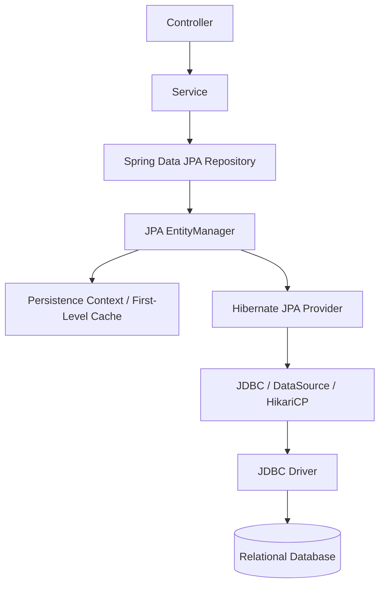
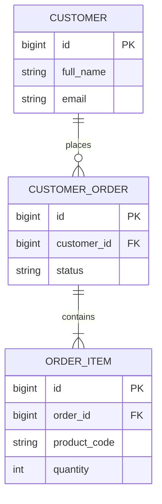
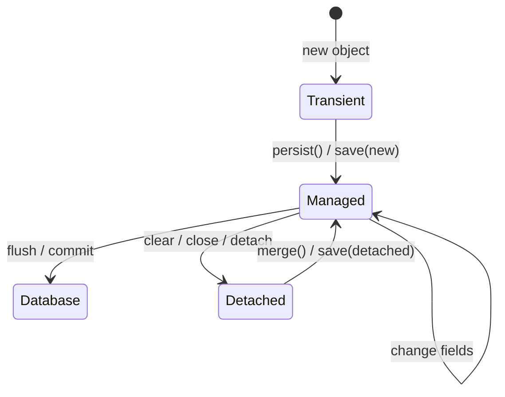
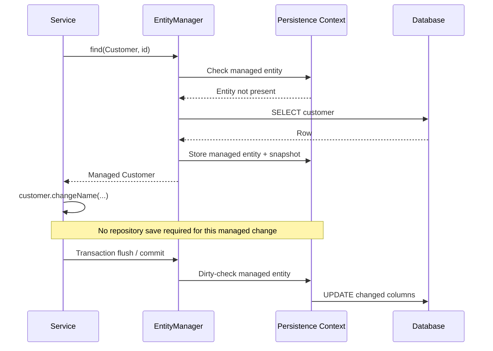
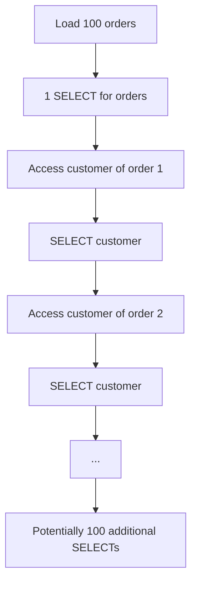
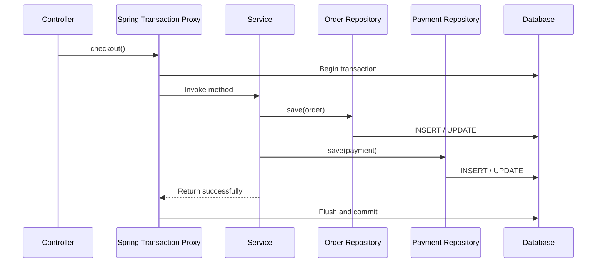
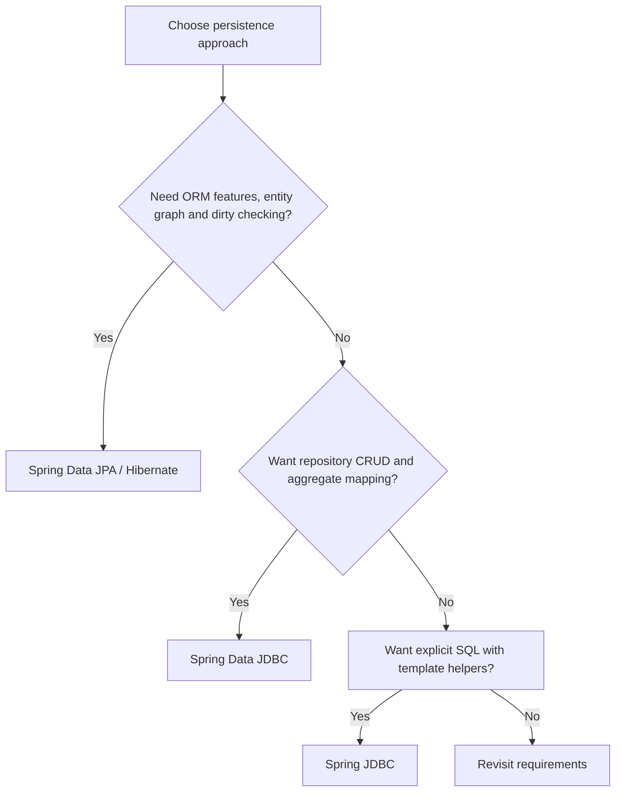

# Spring Data JPA — Visual Guide, Examples & Senior Interview Preparation

A practical, visual-first guide to Spring Data JPA for experienced Java and Spring Boot developers. The examples use **Spring Boot 3+ / Jakarta Persistence** imports (`jakarta.persistence.*`). Let Spring Boot manage compatible Spring Data JPA and Hibernate versions through its dependency management.

> **Core mental model:** Spring Data JPA gives you repository abstractions. JPA defines the persistence standard. Hibernate is commonly the JPA provider that implements it. The EntityManager manages entity state inside a persistence context.

## 1. What is Spring Data JPA?

Spring Data JPA is a Spring Data module that simplifies persistence using the Java Persistence API (JPA). You define entity classes and repository interfaces; Spring Data creates repository implementations and supports derived query methods, JPQL, native SQL, paging, sorting, projections, specifications, auditing, and locking.

Understand the layers:

- **Spring Data JPA:** repository abstraction and query method infrastructure.
- **JPA (Jakarta Persistence):** specification/API defining entities, EntityManager, persistence context, relationships, JPQL, and lifecycle semantics.
- **Hibernate:** commonly used JPA provider; performs ORM work and generates SQL.
- **JDBC:** ultimately used by the provider to communicate with the relational database.

### Architecture diagram



**Important interview distinction:** Spring Data JPA is not Hibernate. Spring Data JPA sits above JPA and provides repository conveniences; Hibernate is one possible JPA implementation.

## 2. Spring Data JPA vs JPA vs Hibernate

| Term | What it is | Responsibility |
|---|---|---|
| JPA / Jakarta Persistence | Standard API/specification | Defines entity mapping, EntityManager, relationships, JPQL, lifecycle and transaction integration contracts |
| Hibernate ORM | JPA provider / ORM implementation | Implements JPA behavior and provides additional ORM capabilities |
| Spring Data JPA | Spring Data module | Creates repositories, derived queries, projections, specifications, auditing integration, and more |

Spring Boot commonly configures Hibernate as the JPA provider when `spring-boot-starter-data-jpa` is included.

## 3. Add dependencies

### Maven — Spring Boot

```xml
<dependencies>
    <dependency>
        <groupId>org.springframework.boot</groupId>
        <artifactId>spring-boot-starter-data-jpa</artifactId>
    </dependency>

    <dependency>
        <groupId>org.postgresql</groupId>
        <artifactId>postgresql</artifactId>
        <scope>runtime</scope>
    </dependency>

    <!-- Optional: validation annotations such as @NotBlank -->
    <dependency>
        <groupId>org.springframework.boot</groupId>
        <artifactId>spring-boot-starter-validation</artifactId>
    </dependency>
</dependencies>
```

Use the Spring Boot parent/BOM and do not pin arbitrary Hibernate or Spring Data versions unless you have a deliberate compatibility reason.

### PostgreSQL application.properties

```properties
spring.datasource.url=jdbc:postgresql://localhost:5432/orders
spring.datasource.username=postgres
spring.datasource.password=${DB_PASSWORD}

# Development convenience only. Prefer Flyway/Liquibase in production.
spring.jpa.hibernate.ddl-auto=validate
spring.jpa.show-sql=false
spring.jpa.properties.hibernate.format_sql=true

# Example pool properties; tune for actual workload.
spring.datasource.hikari.maximum-pool-size=10
spring.datasource.hikari.minimum-idle=2
```

Common `ddl-auto` values:
- `none`: no schema action.
- `validate`: validate mappings against the schema.
- `update`: attempt to update schema; not a replacement for production migrations.
- `create`: create schema, dropping/recreating as provider behavior dictates.
- `create-drop`: create at startup and drop at shutdown.

Use Flyway or Liquibase for production schema evolution. Never use destructive schema modes against valuable production data.

## 4. Entity mapping fundamentals

An entity is a Java class mapped to a database table. It needs an identifier and must follow JPA entity construction/access rules.

### Example: Customer entity

```java
import jakarta.persistence.*;
import java.time.Instant;

@Entity
@Table(name = "customer")
public class Customer {

    @Id
    @GeneratedValue(strategy = GenerationType.IDENTITY)
    private Long id;

    @Column(name = "full_name", nullable = false, length = 120)
    private String fullName;

    @Column(nullable = false, unique = true, length = 180)
    private String email;

    @Column(name = "created_at", nullable = false)
    private Instant createdAt;

    protected Customer() {
        // Required by JPA.
    }

    public Customer(String fullName, String email) {
        this.fullName = fullName;
        this.email = email;
        this.createdAt = Instant.now();
    }

    public Long getId() { return id; }
    public String getFullName() { return fullName; }
    public String getEmail() { return email; }
}
```

Key annotations:
- `@Entity`: marks a persistent entity.
- `@Table`: maps the entity to a table.
- `@Id`: primary key.
- `@GeneratedValue`: primary-key generation strategy.
- `@Column`: column mapping and constraints.
- `@Transient`: excludes a field/property from persistence.
- `@Embeddable` / `@Embedded`: maps a reusable value object into the owning table.
- `@Enumerated`: maps an enum; use `EnumType.STRING` in most business schemas to avoid ordinal fragility.

### Enum mapping

```java
@Enumerated(EnumType.STRING)
@Column(nullable = false)
private OrderStatus status;
```

Prefer string enum persistence for maintainability. Renaming enum constants then requires a controlled data migration.

## 5. Entity relationships — understand the owning side

JPA supports `@OneToOne`, `@OneToMany`, `@ManyToOne`, and `@ManyToMany`. The **owning side** controls the relationship's foreign-key mapping. In a common one-to-many relationship, the child-side `@ManyToOne` owns the foreign key.

### Example: Order and OrderItem



### Order entity

```java
@Entity
@Table(name = "customer_order")
public class PurchaseOrder {

    @Id
    @GeneratedValue(strategy = GenerationType.IDENTITY)
    private Long id;

    @ManyToOne(fetch = FetchType.LAZY, optional = false)
    @JoinColumn(name = "customer_id", nullable = false)
    private Customer customer;

    @Enumerated(EnumType.STRING)
    @Column(nullable = false)
    private OrderStatus status;

    @OneToMany(
        mappedBy = "order",
        cascade = CascadeType.ALL,
        orphanRemoval = true
    )
    private List<OrderItem> items = new ArrayList<>();

    protected PurchaseOrder() {}

    public PurchaseOrder(Customer customer) {
        this.customer = customer;
        this.status = OrderStatus.CREATED;
    }

    public void addItem(OrderItem item) {
        items.add(item);
        item.setOrder(this);
    }

    public void removeItem(OrderItem item) {
        items.remove(item);
        item.setOrder(null);
    }

    public Long getId() { return id; }
    public List<OrderItem> getItems() { return items; }
}
```

### OrderItem entity (owning side)

```java
@Entity
@Table(name = "order_item")
public class OrderItem {

    @Id
    @GeneratedValue(strategy = GenerationType.IDENTITY)
    private Long id;

    @ManyToOne(fetch = FetchType.LAZY, optional = false)
    @JoinColumn(name = "order_id", nullable = false)
    private PurchaseOrder order;

    @Column(name = "product_code", nullable = false)
    private String productCode;

    private int quantity;

    protected OrderItem() {}

    public OrderItem(String productCode, int quantity) {
        this.productCode = productCode;
        this.quantity = quantity;
    }

    void setOrder(PurchaseOrder order) {
        this.order = order;
    }
}
```

### Owning side vs inverse side

- `OrderItem.order` is the owning side because it maps `order_id`.
- `PurchaseOrder.items` is inverse because it uses `mappedBy = "order"`.
- Update both sides in helper methods to keep the in-memory object graph consistent.
- Persisting only the inverse side without setting the owning side can result in a missing or incorrect foreign-key relationship.

**Senior interview tip:** `mappedBy` names the Java association field on the owning side; it is not the database column name.

## 6. Cascade types and orphanRemoval

Cascade controls which entity lifecycle operations propagate from parent to associated entity.

| Cascade | Meaning |
|---|---|
| `PERSIST` | Persist parent propagates persist |
| `MERGE` | Merge parent propagates merge |
| `REMOVE` | Remove parent propagates remove |
| `REFRESH` | Refresh propagates refresh |
| `DETACH` | Detach propagates detach |
| `ALL` | All listed cascade operations |

`orphanRemoval = true` means removing a privately owned child from the relationship causes it to be deleted when the persistence context synchronizes changes.

Use cascade/orphan removal only where the child lifecycle is genuinely owned by the parent. Do not apply `CascadeType.ALL` indiscriminately to shared entities such as Customer, Product, or ReferenceData.

## 7. Repository interfaces

Spring Data JPA creates repository implementations at runtime.

```java
import org.springframework.data.jpa.repository.JpaRepository;

public interface CustomerRepository
        extends JpaRepository<Customer, Long> {

    Optional<Customer> findByEmail(String email);

    boolean existsByEmail(String email);

    List<Customer> findByFullNameContainingIgnoreCase(String name);
}
```

Common APIs:
- `save(entity)`
- `saveAll(entities)`
- `findById(id)`
- `findAll()`
- `findAll(Pageable)`
- `getReferenceById(id)`
- `existsById(id)`
- `delete(entity)`
- `flush()`
- `saveAndFlush(entity)`

`getReferenceById` can return a reference/proxy without immediately loading the row. Accessing state may trigger loading; a missing row may be detected later. It is not equivalent to a fully fetched entity.

## 8. save(): persist vs merge

The repository `save()` method delegates to JPA entity state handling:
- For a new entity, it generally calls `EntityManager.persist()`.
- For an entity considered existing, it generally calls `EntityManager.merge()`.

The precise new-entity detection uses Spring Data's entity information strategy (for example, identifier/version inspection or `Persistable` when implemented).

### Managed vs detached entities



Important:
- `persist()` makes a new entity managed; it does not return a managed copy.
- `merge()` copies detached state into a managed instance and returns that managed instance.
- The object passed to `merge()` may remain detached. Use the returned entity.
- For managed entities inside a transaction, dirty checking usually makes an explicit `save()` unnecessary for each field update; the persistence context flushes changes.
- For detached entities, a merge/save operation is needed to reattach/copy state.

## 9. Persistence context and first-level cache

The persistence context is the EntityManager's set of managed entity instances. Within one persistence context, a given persistent identity maps to one managed object instance.

### Dirty checking flow



This automatic dirty checking is a JPA persistence-context feature, not a Spring Data repository feature by itself.

### First-level cache behavior

Within the same persistence context, repeated lookup by the same entity identity can return the same managed instance without another SELECT. The cache is scoped to the persistence context/EntityManager, not a shared application-wide cache.

## 10. Fetch types: LAZY vs EAGER

| Fetch type | Meaning |
|---|---|
| `LAZY` | Load association when accessed, subject to provider behavior |
| `EAGER` | Association must be available eagerly; provider may use joins or additional queries |

Important defaults in JPA:
- `@ManyToOne`: EAGER by default.
- `@OneToOne`: EAGER by default.
- `@OneToMany`: LAZY by default.
- `@ManyToMany`: LAZY by default.

Prefer explicit LAZY associations for most relationships, then fetch the data needed for each use case using a query, entity graph, or projection. JPA's `LAZY` on to-one associations is a hint to the provider, and actual behavior should be verified with the provider and bytecode/proxy setup.

## 11. N+1 query problem — a common production issue

Suppose you load 100 orders, then access each order's customer. One query loads orders and additional queries load the customers.



Result: 1 + N queries (depending on cache, batch fetching, and provider behavior).

### Fix 1: JPQL fetch join

```java
@Query("""
    select distinct o
    from PurchaseOrder o
    join fetch o.customer
    where o.status = :status
    """)
List<PurchaseOrder> findWithCustomerByStatus(
    @Param("status") OrderStatus status
);
```

### Fix 2: @EntityGraph

```java
@EntityGraph(attributePaths = {"customer", "items"})
List<PurchaseOrder> findByStatus(OrderStatus status);
```

### Fix 3: DTO projection for read use cases

Load only the fields needed by the API/report rather than fully hydrating an entity graph.

Be aware: collection fetch joins can multiply result rows and interact badly with pagination. For paged results, consider a two-step approach (page IDs, then fetch the graph) or a DTO projection.

## 12. Derived query methods

Spring Data parses method names to construct queries.

```java
public interface PurchaseOrderRepository
        extends JpaRepository<PurchaseOrder, Long> {

    List<PurchaseOrder> findByStatus(OrderStatus status);

    List<PurchaseOrder> findByCustomer_Email(String email);

    List<PurchaseOrder> findByStatusOrderByIdDesc(OrderStatus status);

    Optional<PurchaseOrder> findTopByCustomer_EmailOrderByIdDesc(String email);

    long countByStatus(OrderStatus status);

    boolean existsByCustomer_Email(String email);
}
```

Common keywords:
- `And`, `Or`
- `Between`, `LessThan`, `GreaterThan`
- `Containing`, `StartingWith`, `EndingWith`
- `In`, `NotIn`
- `IsNull`, `IsNotNull`
- `IgnoreCase`
- `OrderBy`, `Top`, `First`, `Distinct`

Do not create unreadable method names with many conditions. Move complex query logic to `@Query`, Specifications, or a custom repository.

## 13. JPQL vs native SQL

### JPQL

JPQL queries use **entity names and Java attributes**, not table and column names.

```java
@Query("""
    select o
    from PurchaseOrder o
    where o.status = :status
      and o.customer.email = :email
    """)
List<PurchaseOrder> findOrders(
    @Param("status") OrderStatus status,
    @Param("email") String email
);
```

### Native query

Native queries use database table/column names and database SQL syntax.

```java
@Query(value = """
    SELECT *
    FROM customer_order
    WHERE status = :status
    ORDER BY id DESC
    """, nativeQuery = true)
List<PurchaseOrder> findRecentByStatus(
    @Param("status") String status
);
```

Use JPQL for portable entity-oriented queries. Use native SQL when vendor-specific functions, advanced SQL, or carefully optimized SQL is needed. Native entity queries must return columns compatible with the entity mapping; use DTO/projection mapping for custom result shapes.

## 14. Pagination and sorting

Do not load an unbounded table with `findAll()` for an API endpoint.

```java
Page<PurchaseOrder> findByStatus(
    OrderStatus status,
    Pageable pageable
);
```

Usage:

```java
Pageable pageable = PageRequest.of(
    0,
    20,
    Sort.by(Sort.Direction.DESC, "id")
);

Page<PurchaseOrder> page =
    repository.findByStatus(OrderStatus.CREATED, pageable);

List<PurchaseOrder> content = page.getContent();
long total = page.getTotalElements();
```

- `Page<T>` usually includes total count information and can trigger a count query.
- `Slice<T>` tells whether another slice exists and may avoid the total count query.
- `List<T>` with Pageable can return a limited window without total-page metadata.
- Deep offset pagination can become expensive. Consider keyset/scrolling approaches for high-volume sequential traversal where supported by your Spring Data version and query shape.

## 15. DTO projections

For read endpoints, returning a full entity may load unnecessary columns and associations. Projections can retrieve only the required data.

### Interface projection

```java
public interface OrderSummary {
    Long getId();
    OrderStatus getStatus();
}
```

Repository:

```java
List<OrderSummary> findByStatus(OrderStatus status);
```

### DTO / record projection with JPQL constructor expression

```java
public record OrderView(Long id, String customerName,
                        OrderStatus status) {}
```

```java
@Query("""
    select new com.example.orders.OrderView(
        o.id, o.customer.fullName, o.status
    )
    from PurchaseOrder o
    where o.status = :status
    """)
List<OrderView> findViewsByStatus(
    @Param("status") OrderStatus status
);
```

Use the fully qualified class name in JPQL constructor expressions. Verify constructor parameter types and order.

## 16. @Modifying queries

Use `@Modifying` with `@Query` for bulk UPDATE or DELETE statements.

```java
@Modifying(clearAutomatically = true, flushAutomatically = true)
@Query("""
    update PurchaseOrder o
    set o.status = :newStatus
    where o.id = :id
    """)
int updateStatus(
    @Param("id") Long id,
    @Param("newStatus") OrderStatus newStatus
);
```

Call it inside a transaction:

```java
@Transactional
public void changeStatus(Long id, OrderStatus status) {
    int updated = repository.updateStatus(id, status);
    if (updated != 1) {
        throw new EntityNotFoundException("Order not found");
    }
}
```

Bulk JPQL update/delete operations operate directly against database rows. They bypass normal per-entity dirty checking and lifecycle callbacks for affected managed entities. The persistence context can therefore become stale; flush/clear deliberately or avoid mixing bulk operations with already-managed instances.

## 17. Transactions and propagation

Put business transaction boundaries at the service layer for multi-repository use cases.

```java
@Service
public class CheckoutService {

    private final PurchaseOrderRepository orderRepository;
    private final PaymentRepository paymentRepository;

    public CheckoutService(PurchaseOrderRepository orderRepository,
                           PaymentRepository paymentRepository) {
        this.orderRepository = orderRepository;
        this.paymentRepository = paymentRepository;
    }

    @Transactional
    public void checkout(PurchaseOrder order, Payment payment) {
        orderRepository.save(order);
        paymentRepository.save(payment);

        // If an unchecked exception escapes, both DB operations
        // normally roll back because they participate in this transaction.
    }
}
```

### Transaction flow



Important:
- Default rollback rules generally roll back for unchecked exceptions (`RuntimeException` and `Error`), not checked exceptions.
- Use `rollbackFor` for checked exceptions that must trigger rollback.
- In proxy-based transaction management, self-invocation does not cross the proxy and may bypass the transactional interceptor.
- `readOnly = true` is a hint/optimization, not a universal hard prohibition on writes.
- Avoid external network calls inside a long-running database transaction.
- Understand propagation (`REQUIRED`, `REQUIRES_NEW`, etc.) and isolation for the actual business workflow.

## 18. Optimistic and pessimistic locking

### Optimistic locking with @Version

```java
@Entity
public class Inventory {

    @Id
    @GeneratedValue(strategy = GenerationType.IDENTITY)
    private Long id;

    private int available;

    @Version
    private Long version;
}
```

The provider includes the version in the update condition. If another transaction has changed the row, the update detects the conflict and throws an optimistic locking exception.

```mermaid
sequenceDiagram
    participant A as Transaction A
    participant B as Transaction B
    participant DB as Inventory row (version=7)
    A->>DB: Read version 7
    B->>DB: Read version 7
    A->>DB: Update WHERE version=7
    DB-->>A: Success; version=8
    B->>DB: Update WHERE version=7
    DB-->>B: No matching version
    Note over B: OptimisticLockException
```

### Pessimistic locking

Use a lock when the workflow needs the database to protect a row while it is being processed.

```java
@Lock(LockModeType.PESSIMISTIC_WRITE)
@Query("select i from Inventory i where i.id = :id")
Optional<Inventory> findForUpdate(@Param("id") Long id);
```

Call it inside a transaction. Pessimistic locks can increase contention and deadlock risk; keep the transaction short and acquire locks in a consistent order.

## 19. Specifications for dynamic search

Specifications are useful when filters are optional and composed at runtime.

```java
public class OrderSpecifications {

    public static Specification<PurchaseOrder> hasStatus(OrderStatus status) {
        return (root, query, cb) ->
            status == null ? cb.conjunction()
                           : cb.equal(root.get("status"), status);
    }

    public static Specification<PurchaseOrder> customerEmail(String email) {
        return (root, query, cb) -> {
            if (email == null || email.isBlank()) {
                return cb.conjunction();
            }
            return cb.equal(root.get("customer").get("email"), email);
        };
    }
}
```

Repository:

```java
public interface PurchaseOrderRepository extends
        JpaRepository<PurchaseOrder, Long>,
        JpaSpecificationExecutor<PurchaseOrder> {
}
```

Usage:

```java
Specification<PurchaseOrder> spec =
    Specification.where(OrderSpecifications.hasStatus(status))
        .and(OrderSpecifications.customerEmail(email));

Page<PurchaseOrder> result =
    repository.findAll(spec, PageRequest.of(0, 20));
```

Specifications are most useful for composable predicate logic. For very complex queries, consider Querydsl or a dedicated custom repository. Be careful adding fetch joins to pageable specifications because the count query may need different handling.

## 20. Auditing

Spring Data JPA auditing can populate created/modified dates and users.

Enable:

```java
@Configuration
@EnableJpaAuditing
public class JpaAuditConfiguration {
}
```

Entity:

```java
@Entity
@EntityListeners(AuditingEntityListener.class)
public class AuditedRecord {

    @Id
    @GeneratedValue
    private Long id;

    @CreatedDate
    private Instant createdAt;

    @LastModifiedDate
    private Instant updatedAt;

    @CreatedBy
    private String createdBy;

    @LastModifiedBy
    private String modifiedBy;
}
```

For user fields, provide an `AuditorAware<T>` bean that resolves the current authenticated user. Date-only auditing does not require user identity. Ensure auditing infrastructure and listener configuration are active.

## 21. Entity lifecycle callbacks

Common JPA callbacks:
- `@PrePersist`: before INSERT persistence.
- `@PostPersist`: after INSERT.
- `@PreUpdate`: before entity update.
- `@PostUpdate`: after update.
- `@PreRemove`: before remove.
- `@PostRemove`: after remove.
- `@PostLoad`: after an entity is loaded.

Use listeners for lightweight entity lifecycle concerns. Do not place complicated business workflows or remote service calls inside entity callbacks.

## 22. N+1, lazy loading, and Open Session in View

### LazyInitializationException

A lazy association may be accessed after the persistence context is closed. If it was not initialized while the context was open, Hibernate can throw `LazyInitializationException`.

Better approaches:
- Fetch the required association inside the service transaction with `join fetch` or `@EntityGraph`.
- Use DTO projections for read APIs.
- Define explicit use-case-specific fetch plans.
- Avoid relying on Open Session in View to hide fetch planning problems.

Open Session in View can keep the persistence context open through web response rendering, but it may cause database queries during serialization and obscure performance issues. Decide deliberately whether to enable it.

### N+1 troubleshooting steps

1. Enable SQL logging in a safe development environment or use a SQL inspector.
2. Count statements for the endpoint with realistic test data.
3. Identify which lazy association triggers repeated queries.
4. Choose fetch join, entity graph, batch fetching, or projection based on result shape.
5. Re-measure query count, execution plan, and returned row volume.

Do not fetch-join every association by default; fetching multiple collections can create row multiplication and large result sets.

## 23. Batch inserts and performance tuning

JPA persist operations may execute SQL at flush time. Hibernate supports JDBC batching, but configuration and ID generation strategy affect whether batching is effective.

Example Hibernate properties:

```properties
spring.jpa.properties.hibernate.jdbc.batch_size=50
spring.jpa.properties.hibernate.order_inserts=true
spring.jpa.properties.hibernate.order_updates=true
```

For large insert workloads, periodically flush and clear the persistence context so managed entities do not grow without bound:

```java
@Transactional
public void importRecords(List<Customer> customers) {
    int batchSize = 50;

    for (int i = 0; i < customers.size(); i++) {
        entityManager.persist(customers.get(i));

        if ((i + 1) % batchSize == 0) {
            entityManager.flush();
            entityManager.clear();
        }
    }

    entityManager.flush();
    entityManager.clear();
}
```

Considerations:
- JDBC batching is provider-specific configuration; verify generated SQL and actual batching.
- Identity-based ID generation can prevent Hibernate insert batching in common configurations.
- `flush()` synchronizes pending changes with the database but does not commit the transaction.
- `clear()` detaches all managed entities; references held by the application are no longer managed.
- For very large ETL/bulk loads, Spring JDBC or database-native bulk loading may be more efficient than entity-by-entity ORM persistence.

## 24. Entity equality and hashCode

Entity equality is a nuanced topic because IDs may be generated only after persistence and Hibernate may use proxies.

Practical guidance:
- Avoid blindly using every mutable field in equals/hashCode.
- Do not use a generated ID in a way that changes hash code after inserting an entity into a HashSet/HashMap.
- If using generated IDs, choose a proxy-safe equality strategy and test transient, managed, detached, and proxied instances.
- For value objects, prefer immutable value-based equality.
- Do not use Lombok `@Data` blindly on bidirectional entities: generated equals/hashCode/toString can recurse through relationships or trigger lazy loading.

## 25. Spring JDBC vs Spring Data JDBC vs Spring Data JPA

| Capability | Spring JDBC | Spring Data JDBC | Spring Data JPA |
|---|---|---|---|
| Primary abstraction | JdbcTemplate | Aggregate repository | JpaRepository / EntityManager |
| Mapping | RowMapper | Relational aggregate mapping | JPA entity mapping |
| SQL | Developer-authored | Generated CRUD + custom SQL | JPQL/native + generated CRUD |
| Persistence context | No | No JPA-style persistence context | Yes |
| Dirty checking | No | No | Yes |
| Lazy ORM relationships | No | No JPA lazy proxies | Yes |
| Aggregate boundaries | Application-managed | Central concept | Domain model/entity associations |
| Best use | SQL-centric access | Explicit aggregate-oriented persistence | Rich object-relational domain model |

### Decision tree



## 26. Testing Spring Data JPA

### Repository slice test

```java
@DataJpaTest
class CustomerRepositoryTest {

    @Autowired
    CustomerRepository customerRepository;

    @Test
    void findsCustomerByEmail() {
        customerRepository.save(new Customer("Jordan", "jordan@example.com"));

        Optional<Customer> result =
            customerRepository.findByEmail("jordan@example.com");

        assertTrue(result.isPresent());
        assertEquals("Jordan", result.get().getFullName());
    }
}
```

Testing guidance:
- `@DataJpaTest` focuses on JPA components and often configures an embedded database if one is available.
- Use Testcontainers with the production database family for dialect-sensitive SQL, constraints, migrations, locking, and query behavior.
- Test transactions and flush behavior explicitly. A test that never flushes may not reveal a database constraint failure.
- Use `flush()` and `clear()` in tests when you need to verify real persistence/reload behavior rather than the first-level cache.
- Avoid assuming H2 perfectly reproduces PostgreSQL/MySQL behavior.

## 27. Production best practices

1. Keep business transaction boundaries in service methods.
2. Use LAZY associations by default where appropriate and fetch explicitly per use case.
3. Fix N+1 queries with fetch plans or projections, not blanket EAGER mappings.
4. Use DTO projections for read-heavy APIs and reports.
5. Page or slice large result sets; avoid unbounded `findAll()`.
6. Keep aggregates and entity graphs reasonably sized.
7. Avoid exposing JPA entities directly in REST responses; map to DTOs.
8. Use `@Version` for optimistic concurrency where lost updates matter.
9. Use database constraints to protect data integrity.
10. Use migrations instead of relying on `ddl-auto=update` in production.
11. Understand flush vs commit and the consequences of bulk update/delete.
12. Tune JDBC batching and connection pooling based on measurements.
13. Avoid remote calls inside long-running transactions.
14. Monitor query count, slow SQL, lock contention, pool saturation, and transaction duration.
15. Test against the same database family used in production.

## 28. Senior-level interview questions and answers

### Q1. What is Spring Data JPA?
A Spring Data module that reduces persistence boilerplate by providing repository abstractions, query derivation, JPQL/native queries, projections, specifications, paging, locking, and auditing integration over JPA.

### Q2. Difference between JPA and Hibernate?
JPA is the standard API/specification. Hibernate is an ORM provider that implements JPA and adds provider-specific features.

### Q3. Difference between save() and saveAndFlush()?
`save()` persists or merges the entity and may defer SQL until flush/commit. `saveAndFlush()` requests a flush after saving. Flush sends pending changes to the database but does not commit the transaction.

### Q4. persist() vs merge()?
`persist()` makes a new entity managed. `merge()` copies state from a new/detached object into a managed instance and returns that managed instance. The object passed to merge may remain detached.

### Q5. What is the persistence context?
The EntityManager's set of managed entities, acting as a first-level cache and change-tracking scope. Within it, persistent identity is associated with one managed object instance.

### Q6. What is dirty checking?
The provider detects modifications to managed entities and synchronizes them to the database during flush. It is why a managed entity update inside a transaction often needs no explicit repository save.

### Q7. What is the N+1 problem?
One query loads N parent rows, then accessing a relationship triggers additional queries per parent. Fix it with use-case-specific fetch joins, entity graphs, batch fetching, or DTO projections.

### Q8. Difference between LAZY and EAGER?
LAZY defers association loading until access (provider-dependent); EAGER requires the association to be available eagerly. EAGER does not guarantee one SQL join and can still cause additional queries.

### Q9. What is the owning side?
The side that controls the relationship mapping/foreign-key update. In a typical one-to-many mapping, the child-side ManyToOne owns the foreign key and the parent's collection uses mappedBy.

### Q10. CascadeType.ALL vs orphanRemoval?
Cascade propagates entity lifecycle operations. orphanRemoval deletes a child removed from a privately owned relationship. They solve different lifecycle concerns.

### Q11. What is the difference between flush and commit?
Flush synchronizes pending persistence-context changes to the database within the current transaction. Commit completes the transaction. A flush can occur before commit and the transaction can still roll back afterward.

### Q12. What is the first-level cache?
The persistence-context cache scoped to one EntityManager. It ensures identity consistency and can avoid repeated loads for the same entity identity within that context.

### Q13. What is the second-level cache?
An optional provider-level cache shared across persistence contexts/EntityManagers. It must be configured and invalidated correctly; it is distinct from the first-level cache.

### Q14. How do you implement optimistic locking?
Add a `@Version` property. Provider updates include the expected version; if another transaction changed it first, the update fails and the application handles the conflict.

### Q15. Optimistic vs pessimistic locking?
Optimistic locking detects conflicting changes at update time and is good when conflicts are relatively infrequent. Pessimistic locking obtains database locks to prevent competing updates during the transaction, at the cost of contention and deadlock risk.

### Q16. Why can EAGER loading be harmful?
It can load associations that a use case does not need, create extra selects, large joins, or row multiplication. Prefer explicit fetch plans.

### Q17. What is Open Session in View?
A web integration pattern that keeps the persistence context open through view/response rendering. It can permit lazy loads outside the service transaction, but may hide N+1 problems and cause SQL during serialization.

### Q18. Difference between JPQL and native SQL?
JPQL queries entity names and Java attributes and is more database portable. Native SQL queries physical tables/columns and can use database-specific syntax.

### Q19. What are projections?
Views of selected entity attributes or query results. They avoid loading full entity graphs when an endpoint only needs a subset of data.

### Q20. Why use @Modifying?
It marks a repository query as a modifying bulk UPDATE/DELETE operation. Such queries bypass normal managed-entity dirty checking for affected rows, so flush/clear and stale managed state must be considered.

### Q21. How do you resolve LazyInitializationException?
Fetch required data while the persistence context is active using a fetch join/entity graph, or return a DTO projection. Do not rely on serializing lazy entities after the transaction closes.

### Q22. How do you optimize bulk inserts?
Configure Hibernate JDBC batching, persist in chunks, periodically flush/clear, verify ID strategy compatibility, and consider Spring JDBC/native bulk loading for very large imports.

### Q23. How do you design a many-to-many relationship in a production system?
If the join has business attributes or lifecycle (role, created date, status), model the join table as an explicit entity with two ManyToOne associations rather than a bare ManyToMany.

### Q24. Why should entities not be returned directly from REST controllers?
It couples API contracts to persistence mappings, risks lazy-loading/serialization recursion, exposes internal fields, and can trigger unexpected queries. Map to DTOs.

### Q25. How would you troubleshoot a slow JPA endpoint?
Capture SQL and query counts, inspect execution plans and indexes, find N+1 patterns, review fetch graphs and result size, inspect connection pool and transaction metrics, then measure the change with realistic data.

## 29. One-minute interview summary

> Spring Data JPA is a repository abstraction over the JPA specification, commonly implemented by Hibernate in Spring Boot. Entities are managed by an EntityManager persistence context, which provides first-level caching and dirty checking. I use repositories for CRUD and derived queries, JPQL or native SQL for custom queries, projections for read models, and entity graphs/fetch joins to control loading and prevent N+1 queries. At the service layer, I define transaction boundaries and use optimistic locking with @Version when concurrent updates are possible. In production, I pay close attention to lazy loading, pagination, batch writes, flush behavior, schema migrations, and SQL observability.

## 30. Quick revision cheat sheet

| Concept | Remember |
|---|---|
| Spring Data JPA | Repository abstraction over JPA |
| JPA | Persistence standard/API |
| Hibernate | Common JPA provider |
| `@Entity` | Persistent entity |
| `@Id` | Primary key |
| `@ManyToOne` | Common owning side of a parent-child relation |
| `mappedBy` | Names owning-side Java property |
| Cascade | Propagates lifecycle operations |
| orphanRemoval | Deletes removed privately owned child |
| `JpaRepository` | CRUD, paging, sorting, JPA-specific helpers |
| Persistence context | Managed entity scope / first-level cache |
| Dirty checking | Detects changes to managed entities |
| Flush | Synchronizes changes; does not commit |
| `@Transactional` | Transaction boundary |
| `@Version` | Optimistic locking |
| Fetch join / EntityGraph | Controls association loading |
| DTO projection | Loads only required data |
| N+1 | One parent query + repeated relationship queries |
| `@Modifying` | Bulk UPDATE/DELETE repository query |

## Official references

- [Spring Data JPA Reference Documentation](https://docs.spring.io/spring-data/jpa/reference/)
- [Spring Data JPA — JPA-specific repository features](https://docs.spring.io/spring-data/jpa/reference/jpa.html)
- [Hibernate ORM documentation](https://hibernate.org/orm/documentation/)
- [Spring Boot documentation](https://docs.spring.io/spring-boot/reference/)

---

**Key takeaway:** Know the difference between Spring Data JPA, JPA, and Hibernate; understand entity lifecycle and persistence context; own the relationship mapping; plan fetches to avoid N+1; and use transactions, projections, batching, and locking intentionally.
