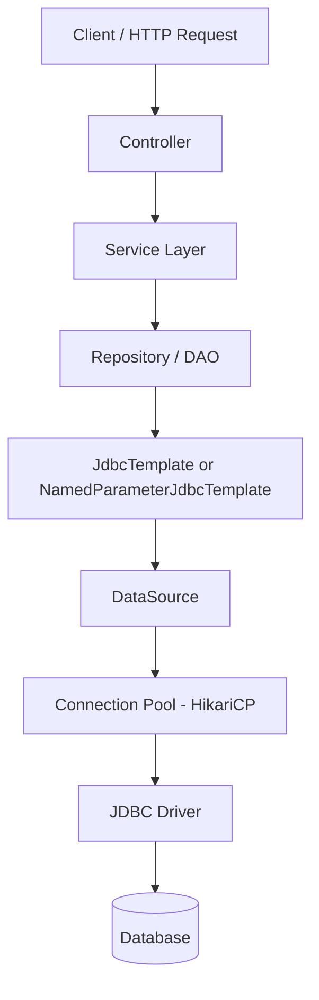
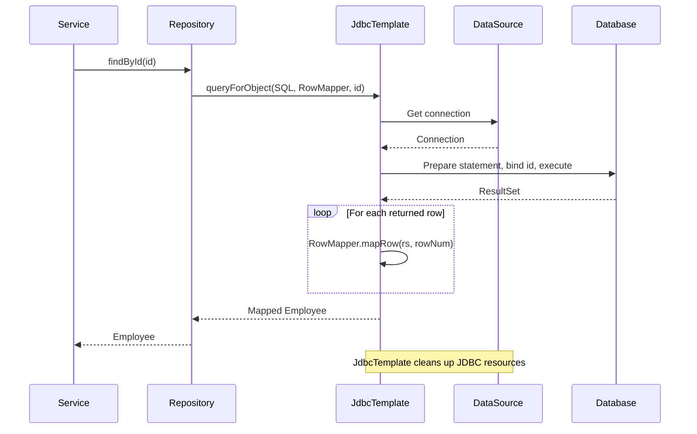
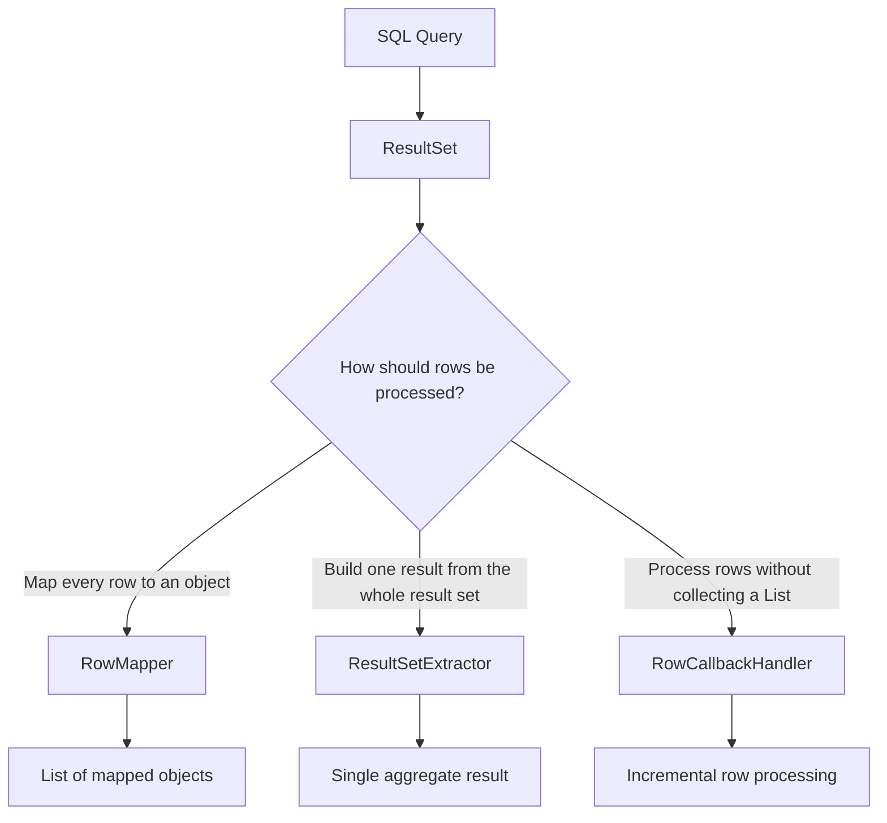
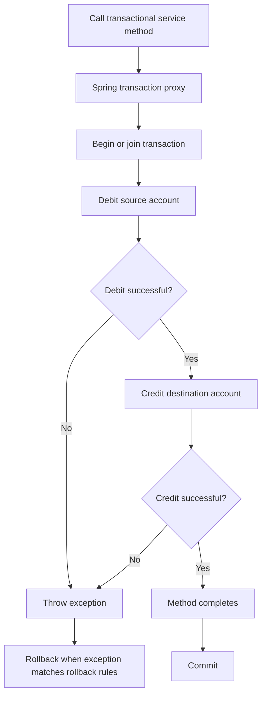
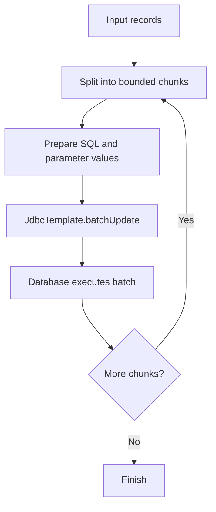
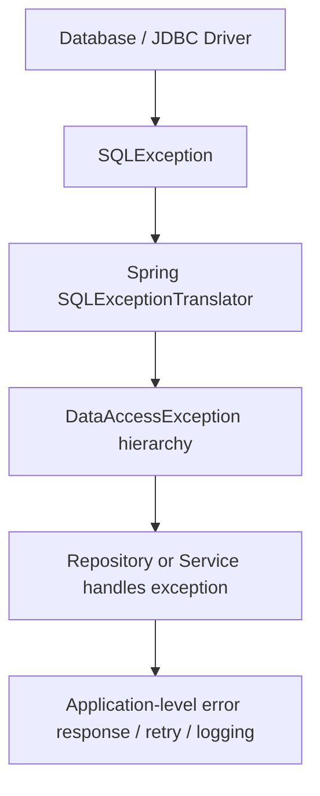
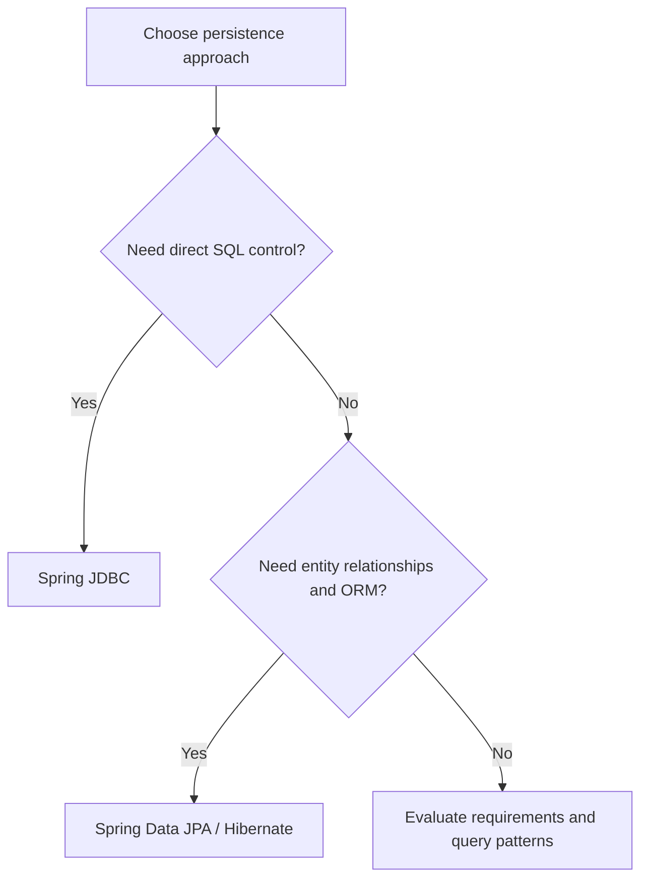
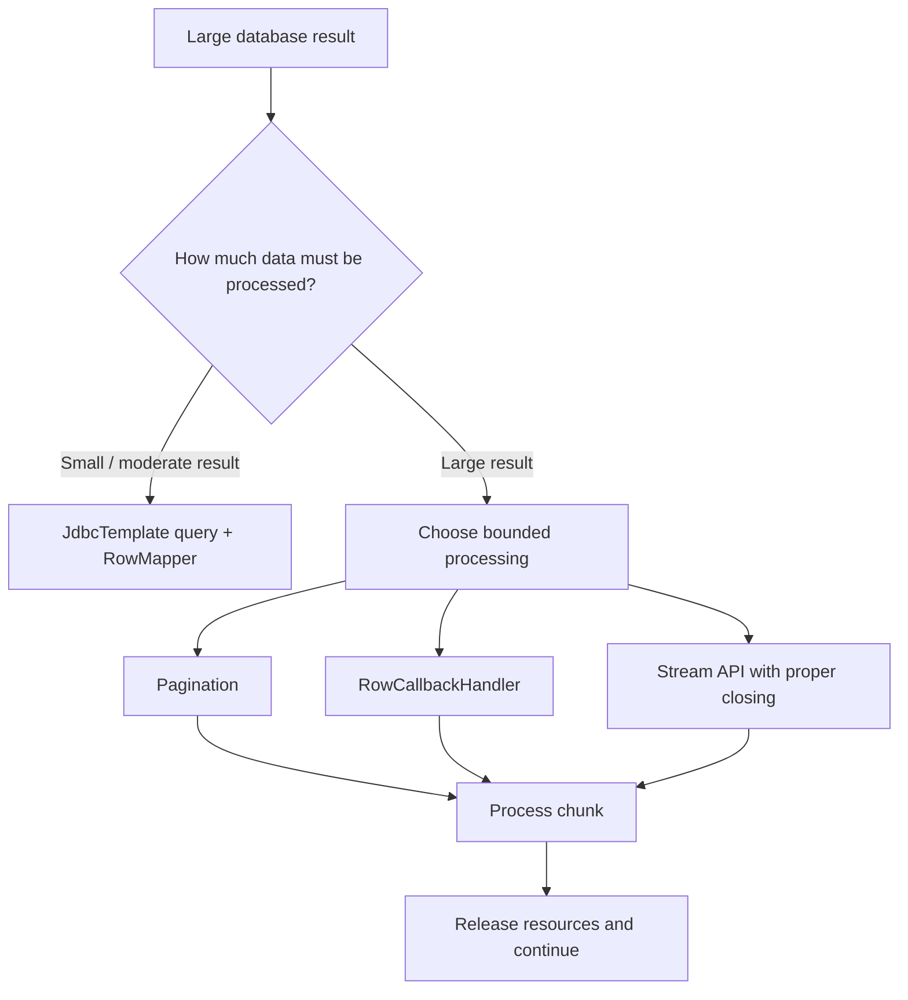

# Spring JDBC — Visual Diagrams

This companion file contains Mermaid diagrams for the concepts in [Readme.md](./Readme.md). GitHub renders Mermaid diagrams directly in Markdown.

## 1. Spring JDBC architecture

**Remember:** The repository owns SQL; JdbcTemplate handles JDBC plumbing; the DataSource supplies connections.

## 2. JdbcTemplate query lifecycle

## 3. RowMapper vs ResultSetExtractor vs RowCallbackHandler

## 4. Transaction flow with @Transactional

**Important:** By default, Spring rolls back for unchecked exceptions and Errors. Checked exceptions need an explicit rollback rule when they should trigger rollback.

## 5. Batch update processing

Batching reduces repeated execution overhead. Use transaction boundaries deliberately: multiple batches are not automatically one all-or-nothing unit unless enclosed in a suitable transaction.

## 6. Spring JDBC exception translation

Examples include `DuplicateKeyException`, `BadSqlGrammarException`, and `CannotGetJdbcConnectionException`.

## 7. Choosing a data access approach

This is a guideline, not a strict rule. Spring JDBC and JPA can coexist when DataSource and transaction management are configured consistently.

## 8. Large result-set processing

Driver fetch-size and cursor behavior vary. Validate streaming behavior with the production database and JDBC driver.

---

[Back to the complete Spring JDBC guide](./Readme.md)
